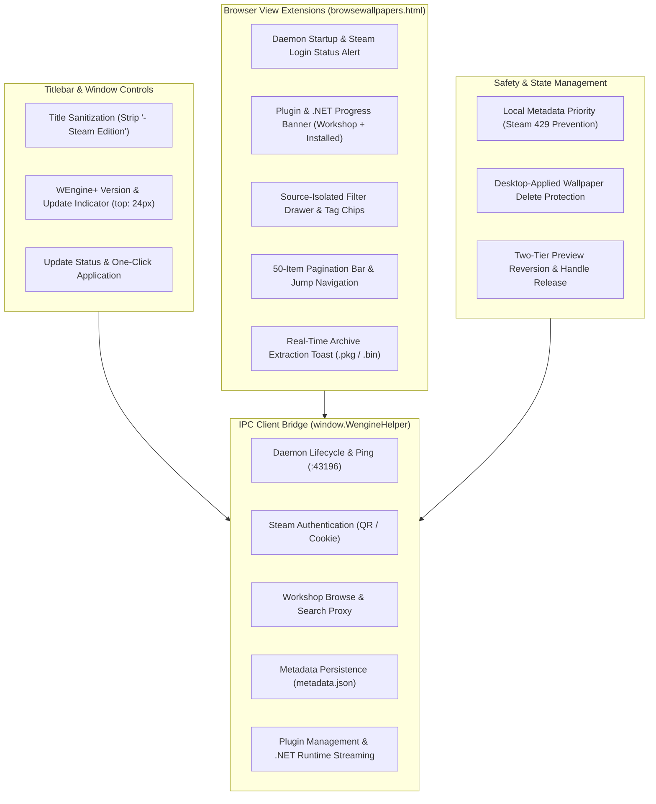

# WEngine-Plus: Frontend (`scripts.js`) Technical Diff Reference

This document provides a technical comparison between the original Wallpaper Engine UI script (`scripts.js`) and the enhanced WEngine-Plus UI script. It serves as an architectural reference and comprehensive diff catalog of all client-side extensions.

> [!NOTE]
> This specification documents changes made strictly to `scripts.js`. Background daemon modules (`wengine-helper.exe`) and backend service implementations are outside the scope of this document.

---

## 1. Executive Summary & Metrics

| Metric | Original (`scripts.js`) | WEngine-Plus (`scripts.js`) | Delta |
| :--- | :--- | :--- | :--- |
| **File Size** | ~1.18 MB (1,186,902 bytes) | ~2.11 MB (2,113,755 bytes) | +926,853 bytes (+78.1%) |
| **Formatting** | Minified (48 lines) | Unminified / Structured JS | Formatted for maintainability |
| **Line Count** | 48 physical lines | 39,571 lines | +39,523 lines |
| **Architectural Scope** | Standalone CEF UI | Hybrid Desktop Client | IPC, isolated filters, caching, safety |

---

## 2. High-Level Integration Architecture

All modifications in `scripts.js` integrate directly into Wallpaper Engine's AngularJS (1.x) frontend framework:



---

## 3. Comprehensive Feature & Component Diff

---

### 3.1. Window Title Sanitization & Version Indicator
* **Location in Source**: Directive `titlebar` (lines ~450–550), filter `localeLoader` (lines ~100–150), template `views/templates/titlebar.html` (line ~39519).
* **Diff Classification**: UI Extension & Title Formatting.

#### Original Baseline:
* The window title displays the raw caption string provided by localization files, appending `- Steam Edition` (e.g., `Wallpaper Engine 2.8.42 - Steam Edition`).
* The titlebar contains only standard window control buttons (minimize, maximize, close, mini-mode) and the title text. No client version indicator or update management interface exists.

#### WEngine-Plus Implementation:
1. **Dynamic Removal of `- Steam Edition`**:
   - `localeLoader` sanitizes `ui_caption_browse` via regex, and a `MutationObserver` on `.titlebar .title` ensures any late or dynamic caption updates maintain the clean title:
     ```javascript
     e && e.ui_caption_browse && (e.ui_caption_browse = e.ui_caption_browse.replace(/\s*-\s*Steam\s+Edition/gi, ""));
     ```
   - The title consistently renders as `Wallpaper Engine <version>`.
2. **Version Display & Update Management Widget**:
   - A dedicated version widget (`.browseWallpaperVersionContainer`) is positioned in the titlebar, centered horizontally under the main title (`top: 24px; left: 0; right: 0; margin: 0 auto; width: max-content;`).
   - Clicking the version label triggers an asynchronous update check; `Shift+Click` triggers an instant mock update test.
   - Dynamically renders state badges: `Checking updates...`, `Latest version`, `New version available` with an `Update` button, real-time download percentage progress, and an error badge with a `Retry` button.
3. **Z-Index Layer Alignment**:
   - The version widget operates with default stacking context (`z-index: auto` / stack level 0), matching `.titlebar .title`.
   - Internal overlays such as monitor selection (`.browseMonitorSelectionContainer`, `z-index: 5`) and modal dialogs (`.modal`, `z-index: 1050`) render above the version widget, preventing the indicator from floating over modal content.

---

### 3.2. Background Daemon IPC Bridge (`window.WengineHelper`)
* **Location in Source**: Lines ~1230–1860.
* **Diff Classification**: Architecture Addition (Client-Daemon Bridge).

#### Original Baseline:
* Default trending filter parameter is hardcoded to `let me = "trend_year";`.
* All Workshop communications rely on internal CEF IPC hooks (`j.callDeferred`). No local HTTP daemon interface exists.

#### WEngine-Plus Implementation:
* Default trending filter set to weekly: `let me = "trend_week";`.
* Introduces the global `window.WengineHelper` client communicating with the local Axum HTTP server (`http://127.0.0.1:43196`):
  ```javascript
  window.WengineHelper = {
    url: "http://127.0.0.1:43196",
    ping: function () { return fetch(this.url + "/api/ping").then(...); },
    ensureRunning: function () {
      var workerExe = dir + "\\wengine-helper.exe";
      window.ui.shellexecute(workerExe, "--daemon");
      return self.waitForPing(15, 250);
    },
    browse: function (params) { return fetch(this.url + "/api/workshop/browse?" + query).then(...); },
    getItemDetails: function (workshopId) { return fetch(this.url + "/api/workshop/item?id=" + encodeURIComponent(workshopId)).then(...); },
    getAllMetadata: function () { return fetch(this.url + "/api/metadata/all").then(...); },
    saveMetadata: function (id, meta) { return fetch(this.url + "/api/metadata/save", ...); },
    deleteMetadata: function (id) { return fetch(this.url + "/api/metadata/delete", ...); },
    downloadItem: function (workshopId, title) { return fetch(this.url + "/api/workshop/download", ...); },
    getDownloadsAll: function () { return fetch(this.url + "/api/workshop/download/all").then(...); },
    extractItem: function (workshopId, title, file) { return fetch(this.url + "/api/workshop/extract", ...); },
    getAuthStatus: function () { return fetch(this.url + "/api/auth/status").then(...); },
    checkUpdate: function (opts) { return fetch(this.url + "/api/update/check", ...).then(...); },
    startUpdateDownload: function () { return fetch(this.url + "/api/update/download", { method: "POST" }).then(...); },
    applyUpdate: function () { return fetch(this.url + "/api/update/apply", { method: "POST" }).then(...); },
    getDotnetStatus: function () { return fetch(this.url + "/api/dotnet/status").then(...); },
    ensureDotnet: function () { return fetch(this.url + "/api/dotnet/ensure", { method: "POST" }).then(...); },
    getPluginStatus: function () { return fetch(this.url + "/api/plugins/status").then(...); },
    startPlugins: function (force) { return fetch(this.url + "/api/plugins/start", ...).then(...); }
  };
  ```

---

### 3.3. Metadata Storage & Installed Wallpaper Caching (Steam 429 Prevention)
* **Location in Source**: Lines ~1860–2050, ~5360–5430.
* **Diff Classification**: Performance Optimization & Network Bypass.

#### Original Baseline:
* Selecting an installed wallpaper executed native `l(e)` and dispatched uncached Steam Community scrape requests for metadata, leading to rapid IP rate-limiting (`HTTP 429 Too Many Requests`).
* Unindexed local projects fell back to generic project objects with misleading `["Everyone", "Local"]` tags.

#### WEngine-Plus Implementation:
1. **Local Disk Metadata Priority (`W.getMetaForWallpaper`)**:
   - Reads wallpaper metadata strictly from the local `metadata.json` store (`W.installedMetadata`).
   - If metadata exists locally, external network requests are bypassed completely:
     ```javascript
     var isInstalledMode = W.sourceIsInstalled || !W.sourceIsWorkshop;
     var curMeta = W.getMetaForWallpaper ? W.getMetaForWallpaper(e) : null;
     if (curMeta) {
       for (var sk = 0; sk < safeKeys.length; sk++) {
         var k = safeKeys[sk];
         if (curMeta[k] !== undefined && curMeta[k] !== null && curMeta[k] !== "") {
           e[k] = curMeta[k];
           if (W.currentSelection) W.currentSelection[k] = curMeta[k];
         }
       }
     }
     if (!isInstalledMode || !curMeta) {
       window.WengineHelper.getItemDetails(wid).then(function (det) {
         if (det && isInstalledMode) {
           W.installedMetadata[String(wid)] = det;
           window.WengineHelper.saveMetadata(wid, det);
         }
       });
     }
     ```
2. **Tag Cleansing**:
   - `W.getInstalledMetadataTags` strips the internal `"Local"` tag from rendered tag chips, displaying only genuine Workshop tags.

---

### 3.4. Wallpaper Sorting System Fixes & Custom Comparators
* **Location in Source**: Lines ~2990–3060, ~3650–3660.
* **Diff Classification**: Bug Fix & Comparator Extension.

#### Original Baseline:
* Native comparators threw errors or caused erratic ordering when item file sizes were zero (`filesize === 0`) or title fields were undefined.
* Supported only basic native properties without awareness of WEngine-Plus metadata fields.

#### WEngine-Plus Implementation:
1. **Robust Value Extraction Helpers**:
   - `getWallpaperSize`: resolves numeric byte size across multiple property aliases (`file_size`, `filesize`, `size`).
   - `getWallpaperInstallDate`: safely parses installation and discovery timestamps.
   - `getWallpaperRatingScore`: normalizes star ratings and percentage scores.
2. **Dedicated Comparators**:
   - Implements safe sorting handlers for `install_date`, `size`, `rating`, `posted_date`, and `updated_date`.
   - Provides safe fallback to alphabetical sorting by name (`.name`) whenever an unrecognized sort key is encountered:
     ```javascript
     ? i.sort(be[W.filter.sort] || be.name)
     : i.sort(he[W.filter.sort] || he.name)
     ```

---

### 3.5. Workshop Query Interception & 50-Item Pagination
* **Location in Source**: Lines ~9660–9900.
* **Diff Classification**: Network Layer Redirection & Pagination Overhaul.

#### Original Baseline:
* Dispatches search queries via native CEF `j.callDeferred("queryWorkshop")`, restricted to Steam's default 30 items per page.
* False network drops trigger `pa(t)`, opening a modal stating "Steam servers are offline".

#### WEngine-Plus Implementation:
1. **Browse Query Redirection**:
   - Intercepts query dispatching and routes requests through `window.WengineHelper.browse(i)`.
   - Populates pagination controls with 50 items per page:
     ```javascript
     if (!xa.cancel && window.WengineHelper) {
       return window.WengineHelper.browse(i).then(function (res) {
         if (res && res.wallpapers) {
           W.pagination.total = res.total_matching || 0;
           W.pagination.pages = res.total_pages || 1;
           W.sortedWallpapers = res.wallpapers;
           W.queryActive = false;
         }
       });
     }
     ```
2. **Offline Modal Suppression**:
   - Function `pa(t)` is neutralized into an empty stub to prevent false-positive offline error popups during local proxying.

---

### 3.6. Independent Filter States & Visibility (Workshop vs. Installed)
* **Location in Source**: Lines ~1380–1450, ~8330–8350, ~9680–9750, ~10410–10430.
* **Diff Classification**: State Management Isolation.

#### Original Baseline:
* A single filter object governed all views. Opening or closing the filter drawer in one tab persisted across all other tabs, and resetting filters indiscriminately purged cross-source state.

#### WEngine-Plus Implementation:
1. **Per-Source Filter Models**:
   - Maintains separate filter configurations for Workshop and Installed:
     ```javascript
     W.filterHelperBySource = {
       installed: createFilterHelper(),
       workshop: createFilterHelper()
     };
     W.filterHelper = W.filterHelperBySource.installed;
     ```
   - Each helper tracks category, type, resolution, age rating, assets (type, genre, script), incompatible items flag, and included/excluded tags independently.
2. **Per-Source Filter Drawer Visibility**:
   - Drawer visibility state is tracked independently per source:
     ```javascript
     W.showFilterBySource = { installed: !1, workshop: !1 };
     W.$watch("showFilter.visible", function (val) {
       if (W.showFilterBySource) {
         if (W.sourceIsWorkshop) W.showFilterBySource.workshop = !!val;
         else if (W.sourceIsInstalled) W.showFilterBySource.installed = !!val;
       }
     });
     ```
   - In `W.setListSource`, the current tab's visibility is saved before switching sources, and the target tab's visibility is restored upon arrival:
     ```javascript
     W.showFilter.visible = W.sourceIsWorkshop
       ? !!W.showFilterBySource.workshop
       : W.sourceIsInstalled
         ? !!W.showFilterBySource.installed
         : !1;
     ```
3. **Source-Aware Reset & Author Isolation**:
   - `callbackResetFilter` resets only the active source's filter helper and search text.
   - Author filters (`filterAuthor.installedAuthor` for Installed, `filterAuthor.authorSteamId` for Workshop) operate in isolation and do not clear each other during tab switches.

---

### 3.7. Comprehensive Status Banners
* **Location in Source**: Lines ~2280–2370, ~2460–2520, template `views/views/browsewallpapers.html` (lines ~39545–39560).
* **Diff Classification**: UI Status & Asynchronous Feedback.

#### Original Baseline:
* No UI indicators exist for daemon health, background Steam authentication, or plugin and runtime dependency downloads.

#### WEngine-Plus Implementation:
1. **Daemon Startup & Steam Authentication Alert**:
   - `W.serviceStartupStatus` verifies local daemon connectivity on launch via `ensureRunning()`.
   - Polls `/api/auth/status`: displays a spinner with *"Log in to Steam..."* during active credential handshakes (`is_logging_in`), transitions to a greeting banner with persona name on success, and auto-dismisses smoothly.
2. **Plugin & .NET Runtime Progress Banner**:
   - Rendered across both Workshop and Installed tabs:
     ```html
     ng-if="(sourceIsWorkshop || sourceIsInstalled) && pluginStatus && (pluginStatus.is_downloading || !pluginsReady || pluginStatus.error)"
     ```
   - Differentiates runtime downloads (`Downloading runtime: .NET Runtime (X%)...`) from plugin component downloads.
   - Automatically polls at 400ms intervals during active downloads, providing smooth progress updates, and includes an interactive `Retry` button upon failure.

---

### 3.8. Wallpaper Deletion & Desktop Wallpaper Protection
* **Location in Source**: Lines ~1500–2130, ~3500–3550, ~6680, ~6857.
* **Diff Classification**: Data Protection & File Lock Safety.

#### Original Baseline:
* No validation checked whether a wallpaper scheduled for deletion was actively running on the Windows desktop. Attempting deletion while previewed resulted in file lock errors (`ERROR_SHARING_VIOLATION`).

#### WEngine-Plus Implementation:
1. **Desktop-Applied vs. UI-Previewed Distinction**:
   - `W._trulyAppliedWallpapers` tracks wallpapers genuinely applied to monitors in Windows settings, differentiating them from temporary preview selections in the UI.
   - `isWallpaperTrulyApplied` validates items strictly against applied monitor assignments.
2. **Active Wallpaper Protection**:
   - Attempting to delete an active desktop wallpaper is blocked and displays an explanatory prompt: *"To delete active wallpaper, please apply another wallpaper first."*.
3. **Two-Tier Preview Reversion & Handle Release**:
   - If an unapplied wallpaper is deleted while currently previewed, the monitor preview is immediately reverted to the applied wallpaper or cleared.
   - Introduces a 250ms asynchronous yield prior to calling HTTP deletion, granting CEF and the worker process (`wallpaper64.exe`) sufficient time to release file handles (`CloseHandle`).

---

### 3.9. Steam Authentication Modal Controller (`SteamLoginModalCtrl`)
* **Location in Source**: Lines ~25450–25910.
* **Diff Classification**: Controller Addition (Authentication).

#### Original Baseline:
* Relied entirely on native Steam client integration; no in-app account management or QR authentication existed.

#### WEngine-Plus Implementation:
* Implements the `SteamLoginModalCtrl` AngularJS controller managing:
  - Saved accounts list with one-click switching.
  - Asynchronous Steam QR code generation and status polling (`/api/auth/qr/status`).
  - Manual Steam Guard session cookie input fallback.

---

### 3.10. Thumbnail Directive & Badges
* **Location in Source**: Lines ~28936–29100.
* **Diff Classification**: UI Enhancement.

#### Original Baseline:
* Displayed a generic floppy disk icon (`fa-save`) on installed items.
* Relied solely on `item.status === 'installed'`.

#### WEngine-Plus Implementation:
* Replaces the disk icon with a green checkmark badge (`fa-check-circle`).
* Identifies installed status through multi-source validation: disk directory matching, active download verification, and helper database state (`WengineHelper.isWallpaperInstalled`).

---

### 3.11. HTML Template Modifications (`$templateCache`)
* **Location in Source**: Lines ~39515–39560.
* **Diff Classification**: Template Cache Overhaul.

| Template Key | WEngine-Plus Extensions |
| :--- | :--- |
| **`views/templates/titlebar.html`** | Embeds version badge directly below the window title with update triggers; aligns Z-layer with `.titlebar .title`. |
| **`views/views/browsewallpapers.html`** | Embeds helper filter drawer (`helperFilterContainer`); 3-state tag chips (`miscTagsList`, `genreTagsList`); bottom pagination bar; metadata display panel; extraction progress toast (`extractStatusNotice`); startup alert; and dual-tab plugin/.NET download banner. |
| **`views/modals/steamloginmodal.html`** | Provides full markup for account selection, Steam mobile QR rendering, and cookie authentication dialogs. |
| **`views/templates/workshopratingstars.html`** | Inline-flex star layout, styled star icons, and precise percentage rating label. |

---

## 4. Modified Components Summary

| Subsystem / Hook | Modification Type | Purpose in `scripts.js` |
| :--- | :--- | :--- |
| **`titlebar` & `localeLoader`** | Extension | Strips `- Steam Edition`, centers version indicator, aligns Z-layer. |
| **`window.WengineHelper`** | Addition | Async HTTP/IPC bridge to background daemon (:43196). |
| **`W.getMetaForWallpaper`** | Optimization | Prioritizes `metadata.json` to prevent Steam HTTP 429 rate limits. |
| **Sorting Comparators** | Bug Fix | Safe extraction for zero-size files; custom date/size/rating sorters. |
| **`queryWorkshop` Interception** | Redirection | Routes queries to local daemon proxy; enforces 50 items/page. |
| **`filterHelperBySource`** | Isolation | Separates filter models and drawer visibility between tabs. |
| **`serviceStartupStatus`** | Addition | UI banner for daemon initialization and Steam authentication status. |
| **`pluginStatus` Banner** | Extension | Displays .NET Runtime and plugin download progress on both tabs. |
| **`isWallpaperTrulyApplied`** | Safety | Protects active desktop wallpapers from premature deletion. |
| **`SteamLoginModalCtrl`** | Addition | Controller for in-app Steam QR and cookie authentication modal. |
| **`$templateCache`** | Template Edit | Inlines all new UI controls directly into AngularJS templates. |
