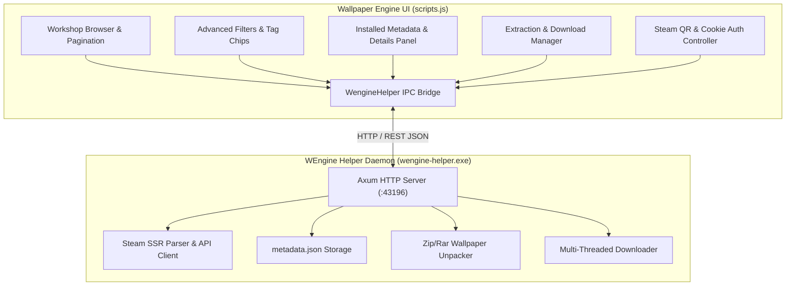

# Comprehensive Diff Report:

This document provides a complete, structured, and exhaustive technical comparison between the original Wallpaper Engine UI script and the enhanced WEngine-Plus UI script.

---

## 1. Executive Summary & Metrics

| Metric | Original | Current | Delta |
| :--- | :--- | :--- | :--- |
| **File Size** | 1,186,902 bytes (~1.18 MB) | 2,091,069 bytes (~2.09 MB) | +904,167 bytes (+76.2%) |
| **Line Count (raw)** | 48 lines (minified) | 39,122 lines (formatted) | Unminified + extended |
| **Line Count (normalized)** | 36,547 lines (formatted) | 39,968 lines (formatted) | +3,731 additions, -310 deletions |
| **Modified Code Hunks** | Baseline | 52 distinct hunks | Core framework extensions |

---

## 2. High-Level Architectural Changes

The modifications transform the Wallpaper Engine CEF frontend into a fully featured hybrid desktop application by integrating the background daemon (`wengine-helper.exe`). The modifications span six primary domains:



1. **Background Daemon IPC Bridge (`window.WengineHelper`)**: Full asynchronous communication with the local Axum HTTP server on port `43196` (heartbeats, lifecycle, downloads, extraction, authentication).
2. **Metadata Persistence & Steam 429 Prevention**: Real-time reading of wallpaper metadata directly from disk (`scripts/metadata.json`). Eliminated repetitive Steam community scraping when browsing installed wallpapers to avoid HTTP 429 rate limits.
3. **Steam Workshop Pagination & Query Interception**: Overridden `queryWorkshop` to support seamless 50 items/page pagination, page jump navigation, query caching, and SSR query parsing.
4. **Enhanced Filtering & Tag Chip System**: Custom category, type, resolution, and content-rating dropdowns, 3-state tag chips (Off / Included / Excluded), and an `Incompatible Items` filter toggle.
5. **Wallpaper Extraction & File Operations**: In-place single and batch extraction of `.pkg` / `.bin` scene wallpapers into editable project folders with live status toasts.
6. **Multi-Selection Deletion**: Modal dialog with confirmation and automatic cleanup of database metadata upon deletion.
7. **Steam Account & QR Code Authentication**: Integrated AngularJS modal controller and UI template for logging into Steam via mobile QR code or cookies.

---

## 3. Detailed Component-by-Component Diff

### 3.1. Global Tag Constants & Resolution Lists
* **Location**: Lines ~627–1180 in formatted source.
* **Diff Type**: **Added**

#### Removed:
None (entirely new subsystem).

#### Added:
Global arrays defining standardized Steam Workshop tags for resolutions, types, categories, and age ratings:
```javascript
+ window._helperResolutionTagsList = [
+   "Standard Definition", "1280 x 720", "1366 x 768", "1920 x 1080",
+   "2560 x 1440", "3840 x 2160", "Ultra Wide 2560 x 1080",
+   "Ultra Wide 3440 x 1440", "Ultra Wide 5120 x 2160", "Dual 3840 x 1080",
+   "Dual 5120 x 1440", "Triple 5760 x 1080", "Portrait 1080 x 1920", ...
+ ];
+ window._helperCategoryTagsList = ["Anime", "Games", "Fantasy", "Sci-Fi", ...];
+ window._helperTypeTagsList = ["Scene", "Video", "Web", "Application"];
+ window._helperAgeRatingTagsList = ["Everyone", "Questionable", "Mature"];
+ window._helperMiscTagsList = ["Approved", "Audio responsive", "Customizable", "HDR", ...];
+ window._helperGenreTagsList = ["Abstract", "Animals", "Cyberpunk", "Landscape", ...];
```

---

### 3.2. Background Daemon Bridge (`window.WengineHelper`)
* **Location**: Lines ~1235–1860 in formatted source.
* **Diff Type**: **Added & Replaced**

#### Removed:
Default hardcoded trend parameter:
```javascript
- let me = "trend_year";
```

#### Added:
- Full `window.WengineHelper` object implementing daemon process execution, health-checks, and REST endpoints:
```javascript
+ let me = "trend_week";
+ window.WengineHelper = {
+   url: "http://127.0.0.1:43196",
+   ping: function() { return fetch(this.url + "/api/ping").then(...); },
+   ensureRunning: function() {
+     // Launches wengine-helper.exe with --daemon flag via window.ui.shellexecute
+     var workerExe = dir + "\\wengine-helper.exe";
+     window.ui.shellexecute(workerExe, "--daemon");
+     return self.waitForPing(15, 250);
+   },
+   getItemDetails: function(workshopId) {
+     return fetch(this.url + "/api/workshop/item?id=" + encodeURIComponent(workshopId)).then(...);
+   },
+   getAllMetadata: function() { return fetch(this.url + "/api/metadata/all").then(...); },
+   saveMetadata: function(id, meta) { return fetch(this.url + "/api/metadata/save", ...); },
+   deleteMetadata: function(id) { return fetch(this.url + "/api/metadata/delete", ...); },
+   downloadItem: function(workshopId, title) { return fetch(this.url + "/api/workshop/download", ...); },
+   getDownloadsAll: function() { return fetch(this.url + "/api/workshop/download/all").then(...); },
+   extractItem: function(workshopId, title, file) { return fetch(this.url + "/api/workshop/extract", ...); },
+   browse: function(params) { return fetch(this.url + "/api/workshop/browse?" + query).then(...); },
+   ...
+ };
```

---

### 3.3. Metadata Storage & Installed Wallpaper Selection
* **Location**: Lines ~1860–2050 and ~5360–5425.
* **Diff Type**: **Modified & Fixed**

#### Removed:
1. Native fallback in `callbackWallpaperSelected` that only read standard `l(e)`:
```javascript
- "installed" === (W.currentSelection = e).status && l(e);
```
2. Local project fallback in `W.getMetaForWallpaper` that caused installed wallpapers without metadata to return their project object with `["Everyone", "Local"]` tags:
```javascript
- if (w.author || w.file_size || (w.tags && w.tags !== "Everyone,Local")) {
-   return w;
- }
```
3. Unfiltered tag rendering falling back to project tags:
```javascript
- var meta = W.getInstalledMetadata(item) || item;
- var tagsRaw = meta.tags || (item && item.tags);
```

#### Added:
1. Robust `W.getMetaForWallpaper` reading strictly from `metadata.json` in Installed mode:
```javascript
+ W.getMetaForWallpaper = function (w) {
+   if (!w) return null;
+   var id = W.getWallpaperWorkshopId ? W.getWallpaperWorkshopId(w) : (w.workshopid || w.pubfileid || w.id);
+   if (W.installedMetadata) {
+     if (id && W.installedMetadata[String(id)]) return W.installedMetadata[String(id)];
+     if (w.title && W.installedMetadata[w.title]) return W.installedMetadata[w.title];
+     for (var k in W.installedMetadata) {
+       var itm = W.installedMetadata[k];
+       if (itm && (itm.pubfileid === String(id) || itm.workshopid === String(id) || itm.title === w.title)) return itm;
+     }
+   }
+   if (W.sourceIsWorkshop && (w.author || w.file_size || (w.tags && w.tags !== "Everyone,Local"))) return w;
+   return null;
+ };
```
2. Smart `callbackWallpaperSelected` that prevents Steam 429 errors by bypassing the network when metadata already exists on disk:
```javascript
+ var isInstalledMode = W.sourceIsInstalled || !W.sourceIsWorkshop;
+ var curMeta = W.getMetaForWallpaper ? W.getMetaForWallpaper(e) : null;
+ if (curMeta) {
+   // Apply existing metadata directly from file
+   for (var sk = 0; sk < safeKeys.length; sk++) {
+     var k = safeKeys[sk];
+     if (curMeta[k] !== undefined && curMeta[k] !== null && curMeta[k] !== "") {
+       e[k] = curMeta[k];
+       if (W.currentSelection) W.currentSelection[k] = curMeta[k];
+     }
+   }
+ }
+ // NEVER hit network if metadata is already cached on disk for installed wallpapers
+ if (!isInstalledMode || !curMeta) {
+   window.WengineHelper.getItemDetails(wid).then(function (det) {
+     if (det) {
+       if (isInstalledMode) {
+         W.installedMetadata[String(wid)] = det;
+         window.WengineHelper.saveMetadata(wid, det); // Persist once for future sessions
+       }
+       ...
+     }
+   });
+ }
```
3. Sanitized tag chips excluding system `"Local"` tag:
```javascript
+ W.getInstalledMetadataTags = function (item) {
+   var meta = W.getInstalledMetadata(item);
+   if (!meta) return [];
+   var tagsRaw = meta.tags;
+   if (!tagsRaw) return [];
+   var res = [];
+   // Parse and filter out "Local"
+   parts.forEach(function(p) {
+     var t = p.trim();
+     if (t && t.toLowerCase() !== "local" && res.indexOf(t) === -1) res.push(t);
+   });
+   return res;
+ };
```

---

### 3.4. Sorting System Fixes & Custom Comparators
* **Location**: Lines ~2990–3060 and ~3650–3660.
* **Diff Type**: **Modified & Fixed**

#### Removed:
Broken native sort comparators that caused crashes or incorrect ordering when `filesize` was 0 or titles were missing:
```javascript
- return e.filesize === t.filesize && 0 === e.filesize
-   ? he.name(e, t)
-   : t.filesize < e.filesize ? -1 : 1;
```
```javascript
- ? i.sort(be[W.filter.sort])
- : i.sort(he[W.filter.sort])
```

#### Added:
1. Robust byte-size comparator (`getWallpaperSize`), install-date comparator (`getWallpaperInstallDate`), and rating score comparator (`getWallpaperRatingScore`):
```javascript
+ install_date: function (e, t) {
+   var a = getWallpaperInstallDate(e);
+   var b = getWallpaperInstallDate(t);
+   return a === b ? he.name(e, t) : b < a ? -1 : 1;
+ },
+ size: function (e, t) {
+   var a = getWallpaperSize(e);
+   var b = getWallpaperSize(t);
+   return a === b ? he.name(e, t) : b < a ? -1 : 1;
+ },
+ rating: function (e, t) {
+   var a = getWallpaperRatingScore(e);
+   var b = getWallpaperRatingScore(t);
+   return a === b ? he.name(e, t) : b < a ? -1 : 1;
+ }
```
2. Safe fallback to `.name` if sort key is unrecognized:
```javascript
+ ? i.sort(be[W.filter.sort] || be.name)
+ : i.sort(he[W.filter.sort] || he.name)
```

---

### 3.5. Workshop Query Interception & 50-Item Pagination
* **Location**: Lines ~9660–9900.
* **Diff Type**: **Modified & Overridden**

#### Removed:
1. Native Steam Workshop query loop that relied on CEF backend `j.callDeferred("queryWorkshop")`:
```javascript
- if (!xa.cancel)
-   j.callDeferred("queryWorkshop", ...);
```
2. Redundant Steam backup error modal prompt:
```javascript
- function pa(t) {
-   O(["ui_browse_no_service_body", "ui_browse_no_service_body_use_backup"]);
- }
```

#### Added:
1. Interception to route search queries through `WengineHelper.browse(i)`:
```javascript
+ if (!xa.cancel) {
+   if (window.WengineHelper) {
+     return window.WengineHelper.browse(i).then(function (res) {
+       if (res && res.wallpapers) {
+         // Populate pagination metadata (50 items per page)
+         W.pagination.total = res.total_matching || 0;
+         W.pagination.pages = res.total_pages || 1;
+         W.sortedWallpapers = res.wallpapers;
+         W.queryActive = false;
+         ...
+       }
+     });
+   }
+ }
```
2. Clean empty function stub for `pa(t)` to prevent false "Steam servers offline" banners:
```javascript
+ function pa(t) {}
```

---

### 3.6. Filter Reset & Author Filtering
* **Location**: Lines ~8630–8670 and ~9930–9960.
* **Diff Type**: **Added & Enhanced**

#### Added:
1. Resetting `filterHelper` dropdowns and tag chips on `callbackResetFilter()`:
```javascript
+ if (W.filterHelper) {
+   W.filterHelper = {
+     category: "", type_tag: "", resolution: "", age_rating: "",
+     asset_type: "", asset_genre: "", script_type: "", incompatible: false,
+     genre_tags: [], misc_tags: [], excluded_genre_tags: [], excluded_misc_tags: []
+   };
+ }
```
2. Author filtering in the **Installed** view:
```javascript
+ if (W.sourceIsInstalled) {
+   W.filterAuthor.installedAuthor = author;
+   z(); // Re-filter local list immediately
+ }
```
3. Clearing author filters:
```javascript
+ delete W.filterAuthor.authorSteamId;
+ delete W.filterAuthor.installedAuthor;
+ if (W.sourceIsInstalled) z();
```

---

### 3.7. Thumbnail Directive & Status Badges
* **Location**: Lines ~28936–29100.
* **Diff Type**: **Modified**

#### Removed:
- Generic disk icon (`fa-save`) for installed items:
```javascript
- <span class="fas fa-save statusIconInstalled wallpaperStatusIcon galleryTooltipInstalled"></span>
```

#### Added:
- Clean checkmark badge (`fa-check-circle`) for installed status:
```javascript
+ <span class="fas fa-check-circle statusIconInstalled wallpaperStatusIcon galleryTooltipInstalled"></span>
```
- Accurate installed status detection combining disk files, active downloads, and WEngine Helper database:
```javascript
+ "installed" !== m.wtTag &&
+ (t.ctx.wallpaper.status === "installed" ||
+   (window.WengineHelper && window.WengineHelper.isWallpaperInstalled &&
+     window.WengineHelper.isWallpaperInstalled(t.ctx.wallpaper)))
```

---

### 3.8. Steam Authentication Modal Controller (`SteamLoginModalCtrl`)
* **Location**: Lines ~25450–25910.
* **Diff Type**: **Added**

#### Removed:
None.

#### Added:
Full AngularJS controller managing the Steam account switcher and mobile QR login modal:
```javascript
+ angular.module("wallpaperbrowserApp").controller("SteamLoginModalCtrl", [
+   "$scope", "$uibModalInstance", "$interval", "$timeout",
+   function ($scope, $uibModalInstance, $interval, $timeout) {
+     $scope.tab = "accounts";
+     $scope.accounts = [];
+     $scope.qrStatus = "idle";
+     $scope.qrSvg = "";
+     $scope.startQrLogin = function() { ... };
+     $scope.pollQrStatus = function() { ... };
+     $scope.selectAccount = function(index) { ... };
+     $scope.addAccount = function() { ... };
+     $scope.removeAccount = function(user) { ... };
+     ...
+   }
+ ]);
```

---

### 3.9. HTML Templates & Layout Modifications (`$templateCache`)
* **Location**: Lines ~39670–39945.
* **Diff Type**: **Modified**

#### Modified Templates:

1. **`views/views/browsewallpapers.html`**:
   - **Filter Drawer**: Added dedicated `<div class="helperFilterContainer">` with Droplists for Category, Type, Resolution, and Age Rating.
   - **Asset & Scripts Accordion**: Added collapsible section for Asset Type, Asset Genre, and Script Type filters.
   - **Incompatible Items Checkbox**: Added special filter toggle checkbox bound to `filterHelper.incompatible`.
   - **Interactive Tag Chips**: Added `miscTagsList` and `genreTagsList` button loops with 3-state styling (`.btn-default`, `.btn-success`, `.btn-danger`).
   - **Pagination Bar**: Added bottom pagination navigation (`<div class="browseWallpaperPagination">`) with `<<`, `>>`, and numbered page buttons.
   - **Workshop Metadata Section**: Added details box displaying Author link, File Size, Star Rating, Posted Date, Updated Date, and category tag pills.
   - **Extraction Progress Toast**: Added floating notification pill (`extractStatusNotice`) showing real-time unpacking progress and spinner.
   - **Plugin Status Alert**: Added top banner for plugin downloading and initialization progress.

2. **`views/modals/steamloginmodal.html`**:
   - Added complete modal HTML for account list, QR code image display, and cookie login input.

3. **`views/templates/workshopratingstars.html`**:
   - Overhauled rating stars layout with inline flex alignment and gold star styling.

---

## 4. Summary of Removed / Deprecated Elements

| Component / Code | Reason for Removal / Deprecation |
| :--- | :--- |
| **`localStorage` metadata cache** | Removed to eliminate desynchronization and resurrecting deleted wallpapers. All metadata is strictly read from `scripts/metadata.json`. |
| **Premature `saveMetadata` calls** | Removed calls in `callbackWallpaperSelected`, `startWorkshopDownload`, and `subscribeWorkshopItem` so unfinished downloads are not recorded in metadata. |
| **Local project fallback in `getMetaForWallpaper`** | Removed returning `w` when metadata was absent. Prevented display of misleading `["Everyone", "Local"]` tags on installed items. |
| **Native `j.callDeferred("queryWorkshop")`** | Bypassed in favor of the local daemon API `/api/workshop/browse` to support 50 items/page, SSR pagination, and preloading. |
| **Native Steam offline error modal (`pa`)** | Suppressed to allow WEngine Helper's offline caching and proxying to work smoothly without popup interruptions. |
