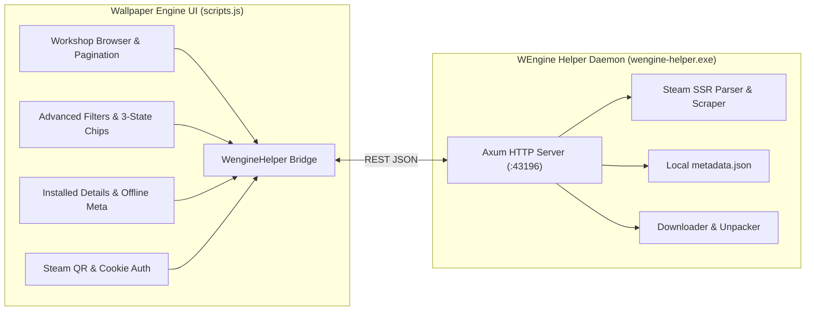

<div align="center">

  # WEngine-Plus

  **Next-generation enhancement mod & lightweight helper daemon for Wallpaper Engine**

  [](LICENSE)
  [](https://www.microsoft.com/windows)
  [](https://www.rust-lang.org)
  [](https://github.com/tokio-rs/axum)
  [](https://tokio.rs)

  [English version](README.md) • [Русская версия](README.ru.md)

</div>

---

## 📖 Overview

**WEngine-Plus** is an all-in-one upgrade suite for Wallpaper Engine. It replaces the stock interface script with an extended frontend (`scripts.js`) connected to a blazingly fast background helper daemon (`wengine-helper.exe`) written in Rust.

Discover, download, and manage Steam Workshop wallpapers directly inside Wallpaper Engine with zero reliance on the desktop Steam client, advanced multi-state filters, instant offline metadata caching, and integrated decompiler.



---

## ✨ Key Features

* **Steam Workshop inside Wallpaper Engine** without running the Steam client
* **Multi-threaded downloading & extraction** in one click
* **Offline metadata storage**
* **Automatic one-click installer**

*Specifically:*

<details open>
<summary><b>Workshop Browser</b></summary>

- **Steam Workshop Integration**: Full in-app workshop browser with search, sorting, and tag filters.
- **Fast SSR Parser & Query Caching**: Server-side Steam HTML parsing and query caching for instant response times.

</details>

<details open>
<summary><b>Download & Extraction</b></summary>

- **Multi-Threaded Downloader**: Parallel asset downloads with live progress toasts and transfer speed tracking.
- **Unpacker**: Built-in decompiler for `.pkg` projects.

</details>

<details>
<summary><b>Steam Authentication & Account Management</b></summary>

- **Web Session**: Quick login via QR code scan, cookie, password, or system account (default).
- **Accounts to Load**: Switch between saved accounts or use the built-in public pool.

</details>

<details>
<summary><b>Built-in Patcher & Safety Backup</b></summary>

- **One-Click Patcher**: Running `wengine-helper.exe` automatically locates `scripts.js`, creates a backup (`scripts.js.bak`), and installs the patched script.
- **Silent Background Execution**: Wallpaper Engine automatically runs the helper daemon with `--daemon` on startup without user intervention.

</details>

---

## 🔍 Detailed Modification Report

For a complete, line-by-line technical audit of all changes between the original Wallpaper Engine script and the enhanced `scripts.js`, see:

[**DIFF.md — Comprehensive Modification Diff**](DIFF.md)

---

## 🚀 Installation

### For End Users

#### Prerequisites
- **Windows 10/11** (x64)
- **Wallpaper Engine** (installed)
- **.NET Runtime 8/9/10** (auto-downloaded if missing)

#### Installation Steps

1. Download the latest `wengine-helper.exe` from [**Releases**](https://github.com/psyattack/WEngine-Plus/releases).
2. Place `wengine-helper.exe` into your Wallpaper Engine scripts directory:
   ```text
   C:\Program Files\Wallpaper Engine\ui\dist\scripts\
   ```
3. Run `wengine-helper.exe`:
   - It will detect `scripts.js`, create a backup (`scripts.js.bak`), and apply the patch.
   - Press **Enter** to close the window.
4. Launch **Wallpaper Engine** normally.

> [!NOTE]
> Wallpaper Engine automatically launches `wengine-helper.exe` in the background with the `--daemon` flag upon startup. You do not need to start it manually.

#### Command-Line Flags

| Flag | Action |
| :--- | :--- |
| `wengine-helper.exe` | **Interactive Patcher (Default)**: Inspects target, creates backup, applies patch, prompts for keypress. |
| `wengine-helper.exe -y` | **Silent Patcher**: Automatically applies patch and exits without confirmation prompt. |
| `wengine-helper.exe --daemon` | **Daemon Mode**: Starts background Axum REST server on port `43196`. |

---

### For Developers

<details>
<summary><b>Development Setup</b></summary>

#### Prerequisites
- **Rust** (v1.75+)
- **Wallpaper Engine**
- **.NET Runtime/SDK 8/9/10**

#### Setup & Build Commands

```bash
# Clone the repository
git clone https://github.com/psyattack/WEngine-Plus.git
cd WEngine-Plus

# Build release executable
cargo build --release
```

The compiled release binary is output to `target/release/wengine-helper.exe`.

</details>

---

## 🛠️ Tech Stack

<table>
<tr>
<td width="50%">

### Frontend
- **AngularJS 1.x** (Wallpaper Engine CEF core)
- **FontAwesome 5** (Status icons & badges)
- **SVG QR Code Renderer**

</td>
<td width="50%">

### Backend
- **Axum 0.8** (Asynchronous HTTP REST API)
- **Tokio 1.x** (Async runtime & multi-threading)
- **Tower-HTTP** (CORS layer)
- **Reqwest 0.12 + Scraper 0.22** (Steam SSR parser)
- **zip + unrar** (Native archive extraction)
- **AES-GCM + SHA-256 + RSA** (Session security)
- **sysinfo + windows-sys** (Win32 process management)

</td>
</tr>
</table>

---

## 📂 Project Structure

<details>
<summary><b>View structure</b></summary>

```
WEngine-Plus/
├── Cargo.toml                        # Rust manifest & dependencies
├── Cargo.lock                        # Locked dependency tree
├── LICENSE                           # MIT License
├── DIFF.md                           # Exhaustive technical diff report
├── README.md                         # English documentation
├── README.ru.md                      # Russian documentation
├── scripts.js                        # Patched Wallpaper Engine frontend script
│
└── src/                              # Backend Rust source code
    ├── main.rs                       # Daemon entry point, CLI routing & Axum server
    ├── patcher.rs                    # Automated script patcher & backup manager
    ├── auth.rs                       # Auth module declarations
    ├── services.rs                   # Services module declarations
    ├── steam.rs                      # Steam module declarations
    │
    ├── auth/                         # Steam authentication subsystem
    │   ├── accounts.rs               # Account pool & QR code login manager
    │   └── auth.rs                   # Session validation & token storage
    │
    ├── services/                     # Application services
    │   ├── dotnet.rs                 # Portable .NET Runtime supervisor & installer
    │   ├── download.rs               # Multi-threaded download manager
    │   ├── extract.rs                # Archive extractor (.pkg, .bin, .zip, .rar)
    │   ├── lifecycle.rs              # Process supervisor & watchdog
    │   ├── metadata.rs               # Local metadata storage (metadata.json)
    │   ├── plugins.rs                # Plugin update & dependency manager
    │   └── settings.rs               # Daemon configuration manager
    │
    └── steam/                        # Steam Workshop scraping & API
        ├── client.rs                 # HTTP client configuration
        ├── parser.rs                 # Steam Workshop HTML scraper
        ├── types.rs                  # Workshop item & query data models
        └── url_builder.rs            # Query string & filter constructor
```

</details>

---

## 📝 Configuration & Data Storage

All operational files are saved directly in the scripts directory:  
**`C:\Program Files\Wallpaper Engine\ui\dist\scripts\`**

| File | Description |
| :--- | :--- |
| `scripts.js` | Enhanced Wallpaper Engine frontend script |
| `scripts.js.bak` | Untouched backup of the original script |
| `metadata.json` | Local metadata database of installed wallpapers |
| `wengine-helper.exe` | Background daemon & script patcher binary |
| `steam_session.json` | Saved Steam Account Session |
| `download_accounts.json` | Saved accounts for download |
| `plugins/` | Auto-downloaded plugins (DepotDownloaderMod, RePKG) |
| `dotnet/` | Portable .NET Runtime 9.0.17 (if needed) |

---

## 🤝 Contributing

Contributions, bug reports, and suggestions are welcome! Feel free to open an Issue or submit a Pull Request.

---

## 📄 License

This project is licensed under the [MIT License](LICENSE).

---

## 🙏 Credits

- **Download Tool:** [DepotDownloaderMod](https://github.com/SteamAutoCracks/DepotDownloaderMod)
- **Package Extractor:** [RePKG](https://github.com/notscuffed/repkg)

---

## ⚠️ Disclaimer

This application is **not affiliated with or endorsed by** Valve Corporation or Wallpaper Engine. Steam and Wallpaper Engine are trademarks of their respective owners.

---

## 💬 Support

For issues, questions, or feature requests, please open an issue on [**GitHub**](https://github.com/psyattack/WEngine-Plus/issues).

---
