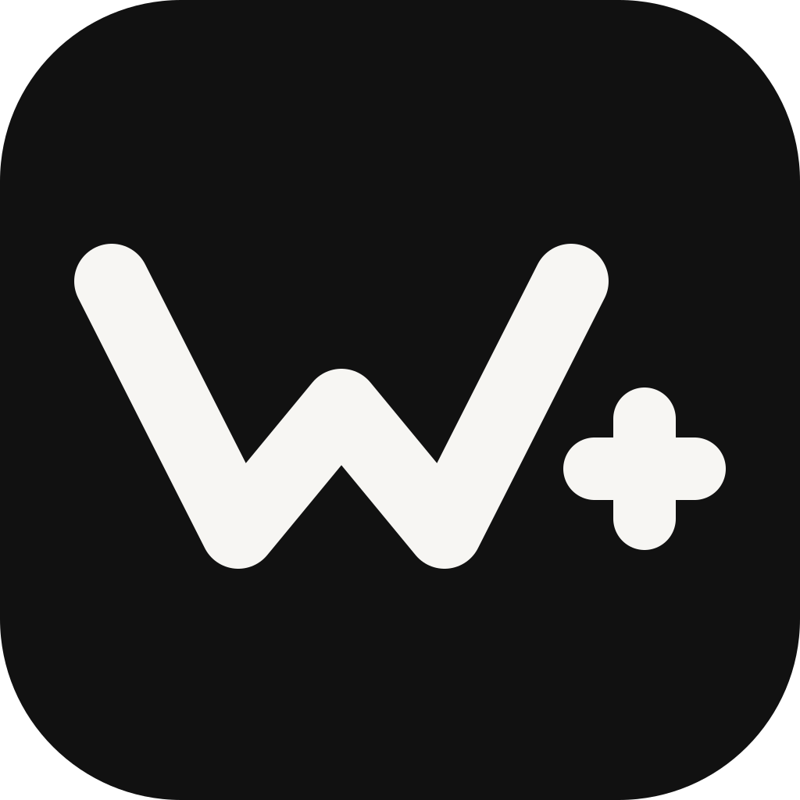
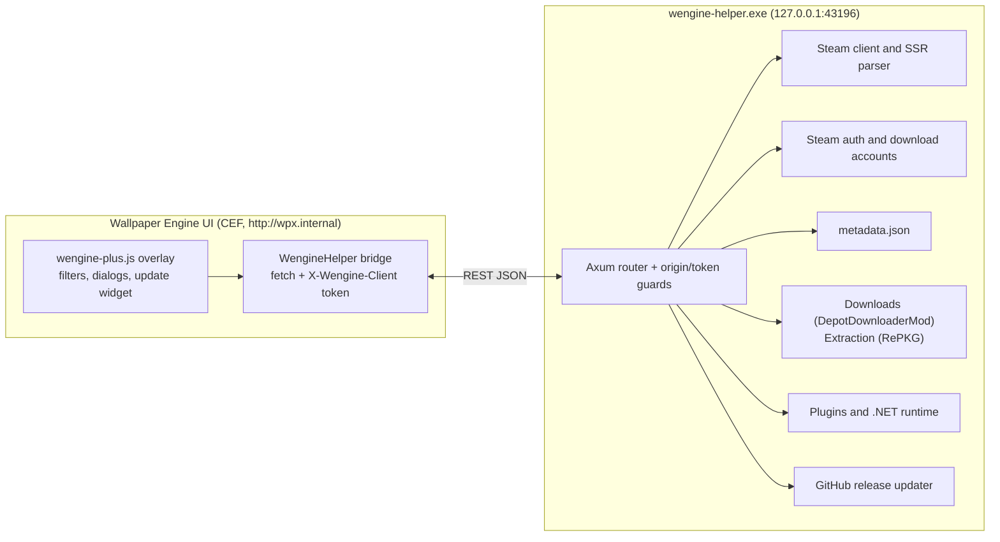

<p align="center">
  
</p>

<h1 align="center">WEngine-Plus</h1>

<p align="center">A Steam Workshop browser, downloader and toolkit inside Wallpaper Engine — backed by a small local helper daemon.</p>

<p align="center">
  <a href="https://github.com/psyattack/WEngine-Plus/releases/latest"></a>
  <a href="https://github.com/psyattack/WEngine-Plus/releases"></a>
  <a href="https://github.com/psyattack/WEngine-Plus/actions/workflows/ci.yml"></a>
  <a href="LICENSE"></a>
  <a href="https://github.com/psyattack/WEngine-Plus/releases/latest"></a>
</p>

<p align="center">
  <strong>English</strong>
  ·
  <a href="README.ru.md">Русский</a>
  ·
  <a href="README.zh.md">简体中文</a>
</p>

> [!WARNING]
> WEngine-Plus modifies Wallpaper Engine's frontend files and downloads community content from Steam
> Workshop. Wallpaper Engine and Steam are trademarks of their respective owners; this project is not
> affiliated with Valve Corporation. Use it at your own risk, as also stated in the license.

## Contents

- [Overview](#overview)
- [Features](#features)
- [Requirements](#requirements)
- [Installation](#installation)
- [Updating and uninstalling](#updating-and-uninstalling)
- [Using WEngine-Plus](#using-wengine-plus)
- [Development](#development)
- [Configuration and data storage](#configuration-and-data-storage)
- [Localization](#localization)
- [Documentation](#documentation)
- [License](#license)
- [Credits](#credits)
- [Support and contributing](#support-and-contributing)

## Overview

WEngine-Plus is an all-in-one upgrade for Wallpaper Engine's Workshop experience. It extends the
stock interface with a runtime overlay (`frontend/wengine-plus.js`) loaded through a one-line hook
appended to the pristine `scripts.js`, and connects it to a local helper daemon
(`wengine-helper.exe`) written in Rust.

The daemon browses Steam Workshop over HTTPS, downloads content with DepotDownloaderMod, unpacks
scene packages with RePKG, keeps a local metadata database and manages Steam sessions and download
accounts. The overlay adds the browser, the three-state filters, the download and extraction
controls, the Steam dialogs and the in-app update widget. The Steam desktop client is not required.



## Features

* **Full Workshop browser inside Wallpaper Engine** — search, sort, author pages, collections and
  pagination, served by the helper instead of the built-in Steam page.
* **Three-state filters** — category, type, age rating, resolution, asset type, asset genre, script
  type and tag chips cycle off → include → exclude, with separate state for Installed and Workshop.
* **One-click downloads** — DepotDownloaderMod runs with multiple parallel connections, live
  progress and automatic fallback through the configured accounts.
* **Scene unpacking** — RePKG extracts `.pkg` packages, per wallpaper or for a multi-selection.
* **Offline metadata** — installed wallpapers keep their size, dates, rating, author and tags in
  `metadata.json`, so details stay available when Steam is slow or rate-limiting.
* **Steam sign-in without the Steam client** — QR code, username and password, cookie, or the system
  account, with the session stored locally.
* **Download accounts** — choose a custom account, the built-in pool or anonymous access.
* **Safe deletion** — active wallpapers are protected, paths are confined to the known wallpaper
  folders, and read-only Steam files are cleaned before removal.
* **Self-updating** — a version chip in the title bar checks GitHub Releases, downloads the release
  archive, verifies its size and SHA-256 digest, replaces itself and reinstalls the frontend patch.
* **Three UI languages** — English, Russian and Simplified Chinese for the WEngine-Plus strings; the
  rest of the interface follows Wallpaper Engine's own language setting.

## Requirements

- **Windows 10 / 11 (x64)**
- **Wallpaper Engine 2.8.42** installed through Steam — the only version WEngine-Plus is developed
  and tested against. Other versions will most likely work too, but they are not guaranteed; if
  something breaks, [open an issue](https://github.com/psyattack/WEngine-Plus/issues/new/choose).
- **.NET Runtime 8 or newer** — optional: the helper downloads a portable .NET 9 runtime when no
  compatible system runtime is found
- Internet access for Steam and for downloading the helper's tools

The helper itself is a single portable executable with no installer and no background service
registration.

## Installation

### For end users

1. Download and extract `WEngine-Plus-v<version>-Windows-x64.zip` from the
   [**latest release**](https://github.com/psyattack/WEngine-Plus/releases/latest).
2. Run the extracted `wengine-helper.exe`. The installer:
   - locates Wallpaper Engine through a running process, the Steam registry and library folders, or
     standard paths (with a folder picker as the last resort);
   - copies itself to `<Wallpaper Engine>\ui\dist\scripts\wengine-helper.exe`;
   - creates `scripts.js.bak` once, appends the one-line overlay loader to `scripts.js` and writes
     `wengine-plus.js` with a per-install API token;
   - starts the helper daemon and removes the downloaded copy.
3. Launch Wallpaper Engine normally. The helper starts with it and stops when the UI closes.

> [!NOTE]
> Wallpaper Engine starts the patched hook for you. If the helper is not running, the overlay starts
> it on demand; you never need to launch it manually.

#### Command-line flags

| Flag | Action |
|---|---|
| no flag | Interactive setup: inspects the target, installs, creates the backup, applies the patch, and waits for a keypress when it opened its own console |
| `--silent`, `-s` | Silent setup: closes Wallpaper Engine, patches, installs, restarts the game, exits |
| `--daemon`, `-d` | Daemon mode: serves the local API on port `43196` |
| `--uninstall`, `-u` | Restores the original frontend and removes helper state; combine with `--silent` for unattended removal |

### For developers

```powershell
# Clone the repository
git clone https://github.com/psyattack/WEngine-Plus.git
cd WEngine-Plus

# Build the release executable
cargo build --release

# Static checks (the CI gate)
cargo check --all-targets
cargo test --all-targets
cargo clippy --all-targets -- -D warnings
node --check frontend/wengine-plus.js
```

The release binary is `target\release\wengine-helper.exe`. See [CONTRIBUTING.md](CONTRIBUTING.md) for
the module map, testing guidance and the overlay conventions.

> [!WARNING]
> The patch is tied to a Wallpaper Engine UI build. The installer prints a warning when the detected
> `version.json` differs from the version this release was built against (`2.8.42`). If the overlay
> stops appearing after a Wallpaper Engine update, run the latest WEngine-Plus installer again.

## Updating and uninstalling

The version chip in the Wallpaper Engine title bar checks GitHub Releases. When a newer release
exists, clicking Update downloads the release archive, verifies its size and SHA-256 digest, extracts
the new executable, replaces the helper, runs the new installer in silent mode and closes the
Wallpaper Engine UI so the patch can be applied. You can also run a freshly downloaded release zip
manually; existing sessions, accounts and metadata are kept.

To uninstall, run `wengine-helper.exe --uninstall` (`--silent` for unattended removal) with Wallpaper
Engine closed. The uninstaller removes the loader line, or restores `scripts.js.bak` when the
installed file cannot be cleaned, then deletes the overlay, token, metadata, sessions, accounts,
logs, plugins, the portable runtime and the executable.

## Using WEngine-Plus

- **Browse** — open the Workshop section in Wallpaper Engine. The overlay adds the WEngine+ version
  chip, the filter panel, the Steam session card and the download controls.
- **Filter** — click a chip once to require the tag, twice to exclude it, a third time to clear it.
  Translated labels never change the value sent to Steam.
- **Sign in** — optional for browsing; required for 18+ content and useful for higher rate limits.
  Four modes are available: QR code, password, cookie and system account.
- **Download** — click Download on a Workshop item. Progress is shown in the UI; downloads can be
  cancelled and the partial folder is removed.
- **Extract** — select installed scene wallpapers and use Extract; choose a destination folder when
  asked. Video and web wallpapers have no package to unpack.
- **Delete** — installed wallpapers can be removed from disk, except the one currently applied to the
  desktop.
- **Update** — click the version chip to check manually, or let it check automatically.

## Development

Requires a recent stable Rust toolchain on Windows and Node.js for the overlay syntax check. The
MSVC build tools also need the Windows SDK resource compiler (`rc.exe`), which `build.rs` uses to
embed the icon and version resources. Wallpaper Engine is only needed for manual testing.

```powershell
cargo run -- --daemon        # start the local API
cargo run -- --silent        # unattended install against a real installation
cargo run                    # interactive installer
```

The overlay has no bundler and the project has no generated sources. `build.rs` only embeds the
Windows icon, version resources and manifest with `winres`; the overlay itself is shipped as-is and
embedded into the executable with `include_str!`.

### Project structure

<details>
<summary>View structure</summary>

```
WEngine-Plus/
├── .github/                 # CI, release workflow, issue and pull-request templates
├── assets/                  # Application icon (SVG source, PNG and ICO exports)
├── docs/                    # Documentation set, indexed in docs/README.md
├── frontend/
│   └── wengine-plus.js      # Runtime overlay: bridge, i18n, AngularJS patches
├── src/
│   ├── main.rs              # Entry, mode dispatch, HTTP routes and handlers
│   ├── setup.rs             # Installer, uninstaller and frontend patching
│   ├── api_security.rs      # Origin/token guards and path containment
│   ├── logging.rs           # Size-capped file logger
│   ├── http.rs              # Shared outbound HTTP client
│   ├── dialog.rs            # Native folder picker
│   ├── auth/                # Steam sessions, QR/cookie login, accounts
│   ├── services/            # Downloads, extraction, plugins, .NET, metadata, updates
│   └── steam/               # Steam client, workshop parser, models, URL builder
├── build.rs                 # Windows resources: icon, VERSIONINFO and manifest
├── Cargo.toml               # Manifest; single source of the version
├── Cargo.lock               # Pinned dependency versions
├── CHANGELOG.md             # Release history
├── CONTRIBUTING.md          # Build, style and pull-request process
├── CODE_OF_CONDUCT.md       # Community standards
├── SECURITY.md              # Vulnerability reporting
├── NOTICES.md               # Third-party dependencies and license texts
├── README.md                # This file
├── README.ru.md             # Russian README
└── README.zh.md             # Simplified Chinese README
```

</details>

Module-level pointers live in [CONTRIBUTING.md](CONTRIBUTING.md) ("Where changes belong"), and how
the pieces behave is described in [docs/ARCHITECTURE.md](docs/ARCHITECTURE.md).

## Configuration and data storage

Everything lives in the Wallpaper Engine scripts directory:
**`<Wallpaper Engine>\ui\dist\scripts\`**.

| File / folder | Contents |
|---|---|
| `scripts.js` | Pristine Wallpaper Engine frontend plus the one-line overlay loader |
| `scripts.js.bak` | Backup of the pristine script |
| `wengine-plus.js` | WEngine-Plus runtime overlay loaded by `scripts.js` |
| `wengine-token` | Per-install token for the local API (also embedded in `wengine-plus.js`) |
| `metadata.json` | Local workshop metadata for installed wallpapers |
| `steam_session.json` | Saved Steam web session |
| `download_accounts.json` | Saved download accounts (passwords are never written to disk) |
| `wengine-helper.log` | Daemon log, one file capped at 8 MiB (the older half is dropped at the limit) |
| `plugins/` | Auto-downloaded DepotDownloaderMod and RePKG |
| `dotnet/` | Portable .NET runtime, only when no system runtime is available |

The local API listens on `127.0.0.1:43196` only. Every request except `GET /api/ping` must carry the
per-install token in the `X-Wengine-Client` header, and browser requests must come from the
Wallpaper Engine UI origin (`http://wpx.internal`) or a loopback origin; everything else is rejected
with `403`. The complete contract is in [docs/API.md](docs/API.md).

## Localization

- Standard Wallpaper Engine strings (sort options, filter values, tag labels, common buttons) come
  from Wallpaper Engine's own `locale/ui_*.json` dictionaries.
- WEngine-Plus strings live in the `ui_wep_*` namespace in `frontend/wengine-plus.js`, with complete
  `en-us`, `ru-ru` and `zh-chs` tables. Any other language falls back to English per key.
- The language follows **Settings → General → Language** in Wallpaper Engine and switches without
  restarting the UI.
- Workshop tags are translated for display only; the original English tag remains the value sent to
  Steam and used by filters.

## Documentation

The full map — which document owns what and who it is for — lives in [docs/README.md](docs/README.md).
Entry points: [FAQ](docs/FAQ.md) for troubleshooting, [API](docs/API.md) for the local HTTP contract,
[ARCHITECTURE](docs/ARCHITECTURE.md) for internals, [CONTRIBUTING](CONTRIBUTING.md) for the build and
review process, and [RELEASING](docs/RELEASING.md) for how versions are cut.

## License

This project is licensed under the [MIT License](LICENSE). Third-party components:
[NOTICES.md](NOTICES.md).

## Credits

- **Download tool:** [DepotDownloaderMod](https://github.com/SteamAutoCracks/DepotDownloaderMod)
- **Package extractor:** [RePKG](https://github.com/notscuffed/repkg)

Both tools are downloaded at runtime and are not bundled with WEngine-Plus; their own licenses apply.

## Support and contributing

- **Bugs and feature requests:** open an issue on
  [**GitHub Issues**](https://github.com/psyattack/WEngine-Plus/issues/new/choose). Include the
  WEngine-Plus version, the Wallpaper Engine version, `winver`, reproduction steps and relevant log
  lines with secrets removed.
- **Questions and troubleshooting:** see [docs/FAQ.md](docs/FAQ.md).
- **Contributing:** the build, overlay rules and review process are in
  [CONTRIBUTING.md](CONTRIBUTING.md); community standards are in
  [CODE_OF_CONDUCT.md](CODE_OF_CONDUCT.md).
- **Security:** report privately as described in [SECURITY.md](SECURITY.md). Do not open a public
  issue for a vulnerability.

> [!NOTE]
> WEngine-Plus automates downloads from Steam Workshop. Respect Steam's terms of service and the
> rights of workshop authors; do not redistribute downloaded content.
