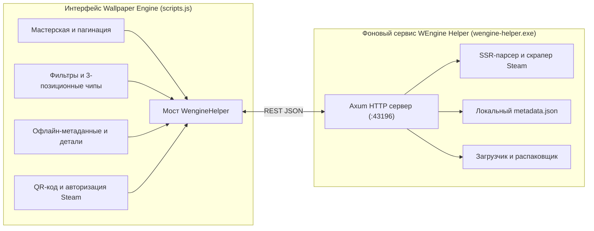

<div align="center">

  # WEngine-Plus

  **Продвинутый мод-патчер и легковесный фоновый демон для Wallpaper Engine**

  [](LICENSE)
  [](https://www.microsoft.com/windows)
  [](https://www.rust-lang.org)
  [](https://github.com/tokio-rs/axum)
  [](https://tokio.rs)

  [English version](README.md) • [Русская версия](README.ru.md)

</div>

---

## 📖 Обзор

**WEngine-Plus** — комплексное расширение для Wallpaper Engine. Оно заменяет стандартный интерфейсный скрипт на расширенный фронтенд (`scripts.js`), работающий в связке с быстрым и легковесным фоновым демоном (`wengine-helper.exe`), написанным на Rust.

Находите, скачивайте и управляйте обоями из Steam Workshop прямо внутри Wallpaper Engine без необходимости запускать настольный клиент Steam, с детальными многопозиционными фильтрами, мгновенным офлайн-кэшированием метаданных и встроенным распаковщиком.



---

## ✨ Основные возможности

* **Мастерская Steam Workshop внутри Wallpaper Engine** без запущенного клиента Steam
* **Загрузка и распаковка** в один клик
* **Локальное хранение метаданных**
* **Автоматический установщик в один клик**

*Конкретнее:*

<details open>
<summary><b>Браузер Workshop</b></summary>

- **Интеграция со Steam Workshop**: Полноценный браузер мастерской внутри приложения с поиском, сортировками и фильтрами тегов.
- **Быстрый SSR-парсер и кэширование**: Серверный парсинг HTML со страниц Steam и кэширование запросов для мгновенного отклика.

</details>

<details open>
<summary><b>Загрузка и распаковка</b></summary>

- **Многопоточный загрузчик**: Параллельное скачивание файлов с отображением скорости и прогресса в реальном времени.
- **Декомпилятор**: Распаковка пакетов `.pkg`.

</details>

<details>
<summary><b>Авторизация Steam и управление аккаунтами</b></summary>

- **Веб сессия**: Быстрый вход через сканирование QR-кода, Cookie, по паролю или вход в системный аккаунт (по умолчанию).
- **Аккаунты для загрузки**: Переключение между сохранёнными учётными записями или использование встроенного публичного пула.

<details>
<summary><b>Встроенный патчер и резервное копирование</b></summary>

- **Установка в один клик**: Запуск `wengine-helper.exe` сам находит файл `scripts.js`, создаёт бэкап (`scripts.js.bak`) и устанавливает патч.
- **Фоновый запуск**: При запуске Wallpaper Engine автоматически стартует сервис в фоновом режиме `--daemon`.

</details>

---

## 🔍 Детальный отчёт изменений

Полное построчное техническое описание всех различий между оригинальным скриптом и модифицированным `scripts.js` доступно в файле:

[**DIFF.md — Полный технический отчёт дифференциала**](DIFF.md)

---

## 🚀 Установка

### Для пользователей

#### Требования
- **Windows 10/11** (x64)
- **Wallpaper Engine** (установленный)
- **.NET Runtime 8/9/10** (загружается автоматически при отсутствии)

#### Инструкция по установке

1. Скачайте последнюю версию `wengine-helper.exe` из раздела [**Releases**](https://github.com/psyattack/WEngine-Plus/releases).
2. Поместите `wengine-helper.exe` в директорию скриптов Wallpaper Engine:
   ```text
   C:\Program Files\Wallpaper Engine\ui\dist\scripts\
   ```
3. Запустите `wengine-helper.exe`:
   - Программа найдет `scripts.js`, создаст резервную копию (`scripts.js.bak`) и применит патч.
   - Нажмите **Enter** для закрытия окна.
4. Запустите **Wallpaper Engine** в обычном режиме.

> [!NOTE]
> При старте Wallpaper Engine автоматически запускает `wengine-helper.exe` в фоновом режиме с флагом `--daemon`. Запускать сервис вручную не требуется.

#### Флаги командной строки

| Флаг | Действие |
| :--- | :--- |
| `wengine-helper.exe` | **Интерактивный патчер (по умолчанию)**: Анализирует файлы, делает бэкап, ставит патч и ожидает нажатия клавиши. |
| `wengine-helper.exe -y` | **Тихий патчер**: Применяет патч и закрывается автоматически без запроса клавиши. |
| `wengine-helper.exe --daemon` | **Режим демона**: Запускает локальный REST сервер на порту `43196`. |

---

### Для разработчиков

<details>
<summary><b>Настройка окружения разработки</b></summary>

#### Требования
- **Rust** (v1.75+)
- **Wallpaper Engine**
- **.NET Runtime/SDK 8/9/10**

#### Команды для сборки

```bash
# Клонирование репозитория
git clone https://github.com/psyattack/WEngine-Plus.git
cd WEngine-Plus

# Сборка оптимизированного релизного бинарника
cargo build --release
```

Готовый релизный файл компилируется в `target/release/wengine-helper.exe`.

</details>

---

## 🛠️ Технологический стек

<table>
<tr>
<td width="50%">

### Frontend
- **AngularJS 1.x** (Основа интерфейса Wallpaper Engine CEF)
- **FontAwesome 5** (Иконки статусов и бейджи)
- **SVG QR Code Renderer**

</td>
<td width="50%">

### Backend
- **Axum 0.8** (Асинхронный HTTP REST API)
- **Tokio 1.x** (Асинхронная среда и многопоточность)
- **Tower-HTTP** (Слой CORS)
- **Reqwest 0.12 + Scraper 0.22** (SSR-парсер страниц Steam)
- **zip + unrar** (Нативная распаковка архивов)
- **AES-GCM + SHA-256 + RSA** (Шифрование сессий)
- **sysinfo + windows-sys** (Управление процессами Win32)

</td>
</tr>
</table>

---

## 📂 Структура проекта

<details>
<summary><b>Просмотр структуры</b></summary>

```
WEngine-Plus/
├── Cargo.toml                        # Манифест зависимостей Rust
├── Cargo.lock                        # Зафиксированное дерево зависимостей
├── LICENSE                           # Лицензия MIT
├── DIFF.md                           # Подробный технический отчёт изменений
├── README.md                         # Документация на английском языке
├── README.ru.md                      # Документация на русском языке
├── scripts.js                        # Модифицированный скрипт интерфейса
│
└── src/                              # Исходный код бэкенда на Rust
    ├── main.rs                       # Точка входа, роутинг CLI и сервер Axum
    ├── patcher.rs                    # Автоматический патчер скриптов и менеджер бэкапов
    ├── auth.rs                       # Модуль авторизации
    ├── services.rs                   # Сервисный модуль
    ├── steam.rs                      # Модуль интеграции со Steam
    │
    ├── auth/                         # Подсистема авторизации Steam
    │   ├── accounts.rs               # Пул аккаунтов и вход по QR-коду
    │   └── auth.rs                   # Проверка сессий и хранение токенов
    │
    ├── services/                     # Сервисы приложения
    │   ├── dotnet.rs                 # Управление и загрузка портативного .NET Runtime
    │   ├── download.rs               # Многопоточный загрузчик
    │   ├── extract.rs                # Распаковщик архивов (.pkg, .bin, .zip, .rar)
    │   ├── lifecycle.rs              # Мониторинг процессов и супервизор
    │   ├── metadata.rs               # Локальное хранилище метаданных (metadata.json)
    │   ├── plugins.rs                # Управление плагинами и зависимостями
    │   └── settings.rs               # Менеджер настроек сервиса
    │
    └── steam/                        # Скрапинг и API мастерской Steam
        ├── client.rs                 # Конфигурация HTTP клиента
        ├── parser.rs                 # HTML скрапер страниц Steam Workshop
        ├── types.rs                  # Модели элементов и запросов
        └── url_builder.rs            # Конструктор поисковых URL и фильтров
```

</details>

---

## 📝 Конфигурация и данные

Все рабочие файлы располагаются непосредственно в папке скриптов:  
**`C:\Program Files\Wallpaper Engine\ui\dist\scripts\`**

| Файл | Описание |
| :--- | :--- |
| `scripts.js` | Модифицированный скрипт интерфейса Wallpaper Engine |
| `scripts.js.bak` | Неизменённая резервная копия оригинального скрипта |
| `metadata.json` | Локальная база метаданных установленных обоев |
| `wengine-helper.exe` | Бинарник фонового демона и патчера |
| `steam_session.json` | Сохранённая сессия аккаунта Steam |
| `download_accounts.json` | Сохранённые аккаунты для загрузки |
| `plugins/` | Автозагружаемые плагины (DepotDownloaderMod, RePKG) |
| `dotnet/` | Портативный .NET Runtime 9.0.17 (если нужен) |

---

## 🤝 Участие в разработке

Приветствуются любые предложения, сообщения об ошибках и пулл-реквесты! Не стесняйтесь открывать Issue или отправлять PR.

---

## 📄 Лицензия

Проект распространяется под лицензией [MIT](LICENSE).

---

## 🙏 Благодарности

- **Инструмент загрузки:** [DepotDownloaderMod](https://github.com/SteamAutoCracks/DepotDownloaderMod)
- **Распаковщик пакетов:** [RePKG](https://github.com/notscuffed/repkg)

---

## ⚠️ Отказ от ответственности

Это приложение **не связано и не одобрено** Valve Corporation или Wallpaper Engine. Steam и Wallpaper Engine являются торговыми марками их соответствующих владельцев.

---

## 💬 Поддержка

По вопросам, проблемам или запросам функций открывайте issue на [**GitHub**](https://github.com/psyattack/WEngine-Plus/issues).

---
