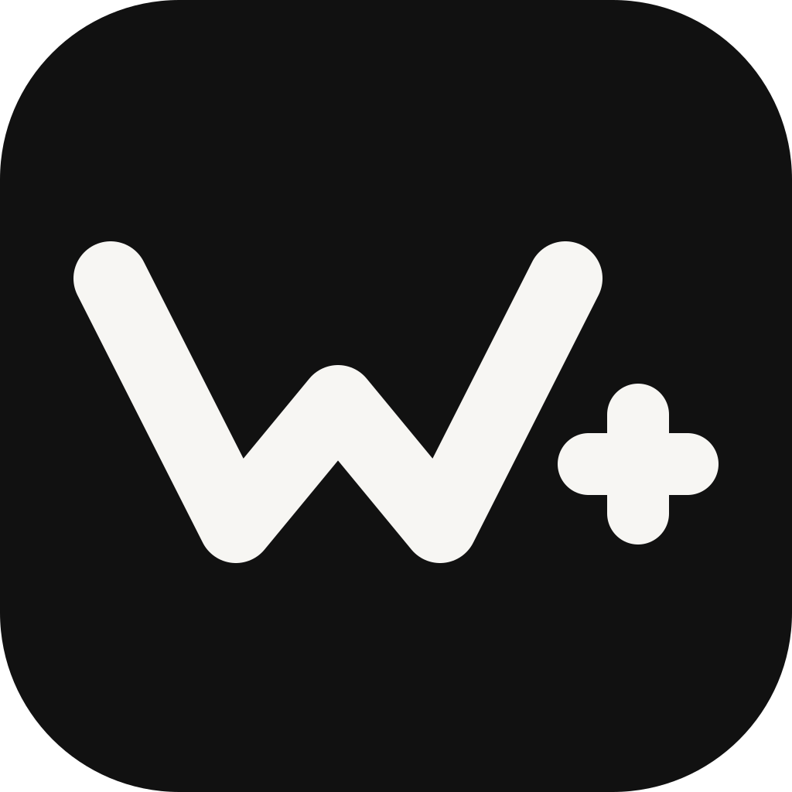
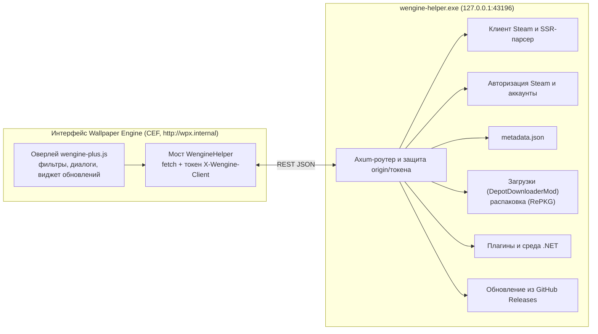

<p align="center">
  
</p>

<h1 align="center">WEngine-Plus</h1>

<p align="center">Браузер Мастерской Steam, загрузчик и набор инструментов внутри Wallpaper Engine — на базе небольшого локального демона-помощника.</p>

<p align="center">
  <a href="https://github.com/psyattack/WEngine-Plus/releases/latest"></a>
  <a href="https://github.com/psyattack/WEngine-Plus/releases"></a>
  <a href="https://github.com/psyattack/WEngine-Plus/actions/workflows/ci.yml"></a>
  <a href="LICENSE"></a>
  <a href="https://github.com/psyattack/WEngine-Plus/releases/latest"></a>
</p>

<p align="center">
  <a href="README.md">English</a>
  ·
  <strong>Русский</strong>
  ·
  <a href="README.zh.md">简体中文</a>
</p>

> [!WARNING]
> WEngine-Plus изменяет файлы интерфейса Wallpaper Engine и загружает контент из Мастерской Steam.
> Wallpaper Engine и Steam — товарные знаки соответствующих владельцев; проект не связан с Valve
> Corporation. Используйте его на свой риск, как указано в лицензии.

## Содержание

- [Обзор](#обзор)
- [Возможности](#возможности)
- [Требования](#требования)
- [Установка](#установка)
- [Обновление и удаление](#обновление-и-удаление)
- [Использование](#использование)
- [Разработка](#разработка)
- [Конфигурация и данные](#конфигурация-и-данные)
- [Локализация](#локализация)
- [Документация](#документация)
- [Лицензия](#лицензия)
- [Благодарности](#благодарности)
- [Поддержка и участие](#поддержка-и-участие)

## Обзор

WEngine-Plus — комплексное расширение работы с Мастерской в Wallpaper Engine. Интерфейс игры
дополняется runtime-оверлеем (`frontend/wengine-plus.js`), который подключается одной строкой-хуком
в конце исходного файла `scripts.js` и общается с локальным демоном-помощником
(`wengine-helper.exe`), написанным на Rust.

Демон ходит в Мастерскую Steam по HTTPS, скачивает контент через DepotDownloaderMod, распаковывает
пакеты сцен через RePKG, ведёт локальную базу метаданных и управляет сессиями Steam и аккаунтами
для загрузки. Оверлей добавляет браузер, трёхпозиционные фильтры, кнопки загрузки и распаковки,
диалоги Steam и виджет обновлений. Клиент Steam при этом не нужен.



## Возможности

* **Полноценный браузер Мастерской внутри Wallpaper Engine** — поиск, сортировка, страницы
  авторов, коллекции и постраничная навигация; данные отдаёт помощник, а не встроенная страница
  Steam.
* **Трёхпозиционные фильтры** — категории, тип, возрастной рейтинг, разрешение, тип и жанр
  ресурсов, тип скриптов и теги переключаются по кругу: выкл. → включить → исключить. Для
  «Установленных» и «Мастерской» состояние фильтров хранится отдельно.
* **Загрузка в один клик** — DepotDownloaderMod работает с несколькими параллельными
  подключениями, показывает прогресс и автоматически перебирает настроенные аккаунты.
* **Распаковка сцен** — RePKG извлекает содержимое `.pkg` для одной или нескольких выбранных
  обоев.
* **Офлайн-метаданные** — установленные обои сохраняют размер, даты, рейтинг, автора и теги в
  `metadata.json`, поэтому карточка остаётся заполненной, даже когда Steam тормозит или ограничивает
  частоту запросов.
* **Вход в Steam без клиента Steam** — QR-код, логин и пароль, cookie или системный аккаунт;
  сессия сохраняется локально.
* **Аккаунты для загрузки** — свой аккаунт, встроенный пул или анонимный доступ.
* **Безопасное удаление** — активные обои защищены, пути ограничены известными папками обоев, а
  read-only файлы Steam очищаются перед удалением.
* **Самообновление** — виджет версии в заголовке проверяет GitHub Releases, скачивает новый
  исполняемый файл, заменяет себя и заново применяет патч интерфейса.
* **Три языка интерфейса** — английский, русский и упрощённый китайский для строк WEngine-Plus;
  остальной интерфейс следует языковой настройке Wallpaper Engine.

## Требования

- **Windows 10 / 11 (x64)**
- **Wallpaper Engine 2.8.42**, установленный через Steam — единственная версия, на которой
  WEngine-Plus разрабатывается и проверяется. На других версиях всё, скорее всего, тоже будет
  работать, но это не гарантируется; если что-то сломается,
  [создайте issue](https://github.com/psyattack/WEngine-Plus/issues/new/choose).
- **.NET Runtime 8 или новее** — необязательно: помощник скачает переносимую среду .NET 9, если
  совместимой системной среды нет
- Доступ в интернет для Steam и для загрузки инструментов помощника

Сам помощник — один переносимый исполняемый файл без установщика и без регистрации фоновой службы.

## Установка

### Для пользователей

1. Скачайте `wengine-helper.exe` из
   [**последнего релиза**](https://github.com/psyattack/WEngine-Plus/releases/latest).
2. Запустите его. Установщик:
   - находит Wallpaper Engine по запущенному процессу, реестру Steam и библиотекам, либо по
     стандартным путям (в крайнем случае открывает выбор папки);
   - копирует себя в `<Wallpaper Engine>\ui\dist\scripts\wengine-helper.exe`;
   - один раз создаёт `scripts.js.bak`, дописывает в `scripts.js` строку-загрузчик оверлея и
     записывает `wengine-plus.js` с индивидуальным токеном API;
   - запускает демон-помощник и удаляет скачанный файл.
3. Запустите Wallpaper Engine как обычно. Помощник стартует вместе с ним и завершается при закрытии
   интерфейса.

> [!NOTE]
> Wallpaper Engine сам загружает патченный хук. Если помощник не запущен, оверлей запустит его по
> требованию — вручную запускать ничего не нужно.

#### Ключи командной строки

| Ключ | Действие |
|---|---|
| без ключей | Интерактивная установка: проверяет цель, устанавливает, создаёт резервную копию, применяет патч и ждёт нажатия Enter, если открыл собственное консольное окно |
| `--silent`, `-s` | Тихая установка: закрывает Wallpaper Engine, патчит, устанавливает, перезапускает игру и завершается |
| `--daemon`, `-d` | Режим демона: локальный API на порту `43196` |
| `--uninstall`, `-u` | Восстанавливает исходный интерфейс и удаляет данные помощника; вместе с `--silent` — без вопросов |

### Для разработчиков

```powershell
# Клонирование репозитория
git clone https://github.com/psyattack/WEngine-Plus.git
cd WEngine-Plus

# Сборка release-исполняемого файла
cargo build --release

# Статические проверки (тот же набор, что в CI)
cargo check --all-targets
cargo test --all-targets
cargo clippy --all-targets -- -D warnings
node --check frontend/wengine-plus.js
```

Release-бинарник — `target\release\wengine-helper.exe`. Карта модулей, правила тестирования и
соглашения по оверлею описаны в [CONTRIBUTING.md](CONTRIBUTING.md).

> [!WARNING]
> Патч привязан к сборке интерфейса Wallpaper Engine. Установщик предупреждает, если обнаруженная
> версия в `version.json` отличается от версии, под которую собран релиз (`2.8.42`). Если после
> обновления Wallpaper Engine оверлей перестал появляться, запустите установщик последней версии
> WEngine-Plus.

## Обновление и удаление

Виджет версии в заголовке Wallpaper Engine проверяет GitHub Releases. Если есть новая версия, нажатие
«Обновить» скачивает её, проверяет исполняемый файл, заменяет помощника, запускает новый установщик
в тихом режиме и закрывает интерфейс Wallpaper Engine, чтобы применить патч. Можно и просто запустить
скачанный релиз вручную: сессии, аккаунты и метаданные сохраняются.

Для удаления закройте Wallpaper Engine и запустите `wengine-helper.exe --uninstall` (`--silent` —
без вопросов). Деинсталлятор удаляет строку-загрузчик или восстанавливает `scripts.js.bak`, если
текущий файл очистить нельзя, а затем удаляет оверлей, токен, метаданные, сессии, аккаунты, логи,
плагины, переносимую среду .NET и сам исполняемый файл.

## Использование

- **Обзор** — откройте раздел «Мастерская» в Wallpaper Engine. Оверлей добавляет виджет версии
  WEngine+, панель фильтров, карточку сессии Steam и кнопки загрузки.
- **Фильтры** — один клик по чипу требует тег, второй исключает его, третий сбрасывает. Перевод
  подписи не меняет значение, отправляемое в Steam.
- **Вход** — необязателен для просмотра; нужен для контента 18+ и помогает при ограничениях частоты
  запросов. Доступны четыре режима: QR-код, пароль, cookie и системный аккаунт.
- **Загрузка** — нажмите «Скачать» на элементе Мастерской. Прогресс показывается в интерфейсе;
  загрузку можно отменить, и незавершённая папка будет удалена.
- **Распаковка** — выберите установленные сцены и нажмите «Распаковать»; при первом запуске
  предложится папка назначения. У видео- и веб-обоев пакета для распаковки нет.
- **Удаление** — установленные обои можно удалить с диска, кроме тех, что сейчас применены к
  рабочему столу.
- **Обновление** — нажмите на виджет версии для ручной проверки или дождитесь автоматической.

## Разработка

Нужен свежий стабильный Rust для Windows и Node.js для проверки синтаксиса оверлея. Сборке MSVC
также нужен компилятор ресурсов Windows SDK (`rc.exe`): `build.rs` встраивает иконку и ресурсы
версии. Wallpaper Engine требуется только для ручного тестирования.

```powershell
cargo run -- --daemon        # запуск локального API
cargo run -- --silent        # тихая установка в реальную инсталляцию
cargo run                    # интерактивный установщик
```

У оверлея нет сборщика, а в проекте нет генерируемых исходников. `build.rs` только встраивает
иконку Windows, ресурсы версии и манифест через `winres`; сам оверлей поставляется как есть и
встраивается в исполняемый файл через `include_str!`.

### Структура проекта

<details>
<summary>Показать структуру</summary>

```
WEngine-Plus/
├── .github/                 # CI, release-воркфлоу, шаблоны issue и pull request
├── assets/                  # Иконка приложения (исходник SVG, экспорт PNG и ICO)
├── docs/                    # Документация, индекс в docs/README.md
├── frontend/
│   └── wengine-plus.js      # Runtime-оверлей: мост, i18n, патчи AngularJS
├── src/
│   ├── main.rs              # Вход, выбор режима, HTTP-маршруты и обработчики
│   ├── setup.rs             # Установщик, деинсталлятор и патч интерфейса
│   ├── api_security.rs      # Защита origin/токена и ограничение путей
│   ├── logging.rs           # Файловый логгер с ограничением размера
│   ├── http.rs              # Общий исходящий HTTP-клиент
│   ├── dialog.rs            # Нативный выбор папки
│   ├── auth/                # Сессии Steam, вход по QR/cookie, аккаунты
│   ├── services/            # Загрузки, распаковка, плагины, .NET, метаданные, обновления
│   └── steam/               # Клиент Steam, парсер Мастерской, модели, сборка URL
├── build.rs                 # Ресурсы Windows: иконка, VERSIONINFO и манифест
├── Cargo.toml               # Манифест; единственный источник версии
├── Cargo.lock               # Зафиксированные версии зависимостей
├── CHANGELOG.md             # История релизов
├── CONTRIBUTING.md          # Сборка, стиль и процесс pull request
├── CODE_OF_CONDUCT.md       # Нормы сообщества
├── SECURITY.md              # Сообщение об уязвимостях
├── NOTICES.md               # Сторонние зависимости и тексты лицензий
├── README.md                # Английская версия
├── README.ru.md             # Этот файл
└── README.zh.md             # Упрощённый китайский
```

</details>

Карта модулей — в [CONTRIBUTING.md](CONTRIBUTING.md) («Where changes belong»), а поведение
описано в [docs/ARCHITECTURE.md](docs/ARCHITECTURE.md).

## Конфигурация и данные

Всё хранится в папке скриптов Wallpaper Engine:
**`<Wallpaper Engine>\ui\dist\scripts\`**.

| Файл / папка | Содержимое |
|---|---|
| `scripts.js` | Исходный интерфейс Wallpaper Engine плюс одна строка-загрузчик оверлея |
| `scripts.js.bak` | Резервная копия исходного скрипта |
| `wengine-plus.js` | Runtime-оверлей WEngine-Plus, загружаемый из `scripts.js` |
| `wengine-token` | Индивидуальный токен локального API (также встроен в `wengine-plus.js`) |
| `metadata.json` | Локальные метаданные Мастерской для установленных обоев |
| `steam_session.json` | Сохранённая веб-сессия Steam |
| `download_accounts.json` | Сохранённые аккаунты для загрузки (пароли не записываются на диск) |
| `wengine-helper.log` | Лог демона, один файл с лимитом 8 МиБ (при заполнении старая половина стирается) |
| `plugins/` | Автоматически скачанные DepotDownloaderMod и RePKG |
| `dotnet/` | Переносимая среда .NET, только если системной нет |

Локальный API слушает только `127.0.0.1:43196`. Каждый запрос, кроме `GET /api/ping`, обязан
содержать индивидуальный токен в заголовке `X-Wengine-Client`, а запросы браузера должны приходить
с origin `http://wpx.internal` (UI Wallpaper Engine) или loopback; всё остальное отклоняется с
`403`. Полный контракт — в [docs/API.md](docs/API.md).

## Локализация

- Стандартные строки Wallpaper Engine (сортировки, значения фильтров, теги, общие кнопки) берутся
  из его собственных словарей `locale/ui_*.json`.
- Строки WEngine-Plus живут в пространстве `ui_wep_*` в `frontend/wengine-plus.js` с полными
  таблицами `en-us`, `ru-ru` и `zh-chs`. Любой другой язык получает английский текст по каждому
  ключу.
- Язык следует настройке **Настройки → Общие → Язык** в Wallpaper Engine и меняется без перезапуска
  интерфейса.
- Теги Мастерской переводятся только для отображения; в Steam и в фильтры по-прежнему уходит
  исходный английский тег.

## Документация

Полная карта — какой документ за что отвечает и для кого он — в [docs/README.md](docs/README.md).
Точки входа: [FAQ](docs/FAQ.md) для решения проблем, [API](docs/API.md) для локального HTTP-контракта,
[ARCHITECTURE](docs/ARCHITECTURE.md) для внутреннего устройства, [CONTRIBUTING](CONTRIBUTING.md) для
сборки и ревью, [RELEASING](docs/RELEASING.md) для процесса выпуска версий.

## Лицензия

Проект распространяется по [лицензии MIT](LICENSE). Сторонние компоненты —
в [NOTICES.md](NOTICES.md).

## Благодарности

- **Инструмент загрузки:** [DepotDownloaderMod](https://github.com/SteamAutoCracks/DepotDownloaderMod)
- **Распаковщик пакетов:** [RePKG](https://github.com/notscuffed/repkg)

Оба инструмента скачиваются во время работы и не входят в поставку WEngine-Plus; действуют их
собственные лицензии.

## Поддержка и участие

- **Ошибки и предложения:** создайте issue на
  [**GitHub Issues**](https://github.com/psyattack/WEngine-Plus/issues/new/choose). Укажите версию
  WEngine-Plus, версию Wallpaper Engine, `winver`, шаги воспроизведения и относящиеся к делу строки
  лога без секретов.
- **Вопросы и решение проблем:** см. [docs/FAQ.md](docs/FAQ.md).
- **Участие в разработке:** сборка, правила оверлея и процесс ревью — в
  [CONTRIBUTING.md](CONTRIBUTING.md); нормы общения — в [CODE_OF_CONDUCT.md](CODE_OF_CONDUCT.md).
- **Безопасность:** сообщайте приватно, как описано в [SECURITY.md](SECURITY.md). Не открывайте
  публичный issue по уязвимости.

> [!NOTE]
> WEngine-Plus автоматизирует загрузку контента из Мастерской Steam. Соблюдайте условия
> использования Steam и права авторов; не распространяйте скачанный контент.
