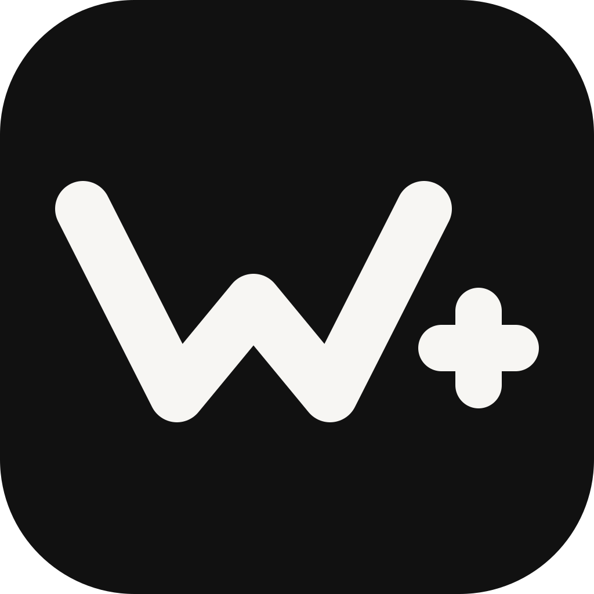
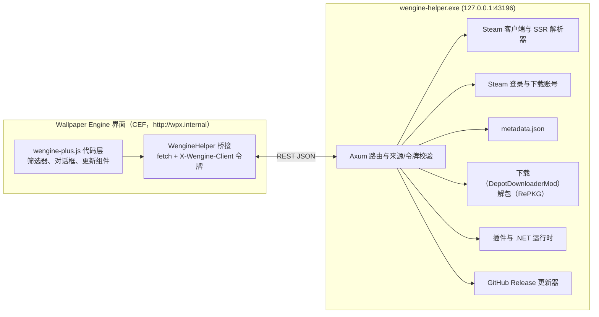

<p align="center">
  
</p>

<h1 align="center">WEngine-Plus</h1>

<p align="center">Wallpaper Engine 内的 Steam 创意工坊浏览器、下载器与工具箱，由本地辅助服务提供支持。</p>

<p align="center">
  <a href="https://github.com/psyattack/WEngine-Plus/releases/latest"></a>
  <a href="https://github.com/psyattack/WEngine-Plus/releases"></a>
  <a href="https://github.com/psyattack/WEngine-Plus/actions/workflows/ci.yml"></a>
  <a href="LICENSE"></a>
  <a href="https://github.com/psyattack/WEngine-Plus/releases/latest"></a>
</p>

<p align="center">
  <a href="README.md">English</a>
  ·
  <a href="README.ru.md">Русский</a>
  ·
  <strong>简体中文</strong>
</p>

> [!WARNING]
> WEngine-Plus 会修改 Wallpaper Engine 的前端文件并从 Steam 创意工坊下载社区内容。Wallpaper
> Engine 与 Steam 均为其各自所有者的商标；本项目与 Valve Corporation 无关。使用风险自负，详见
> 许可证。

## 目录

- [概述](#概述)
- [功能](#功能)
- [系统要求](#系统要求)
- [安装](#安装)
- [更新与卸载](#更新与卸载)
- [使用](#使用)
- [开发](#开发)
- [配置与数据](#配置与数据)
- [本地化](#本地化)
- [文档](#文档)
- [许可证](#许可证)
- [致谢](#致谢)
- [支持与贡献](#支持与贡献)

## 概述

WEngine-Plus 是对 Wallpaper Engine 创意工坊体验的一体化增强。它通过附加在原始 `scripts.js`
末尾的一行钩子加载运行时代码层（`frontend/wengine-plus.js`），并连接到用 Rust 编写的本地辅助
服务（`wengine-helper.exe`）。

辅助服务通过 HTTPS 浏览 Steam 创意工坊，使用 DepotDownloaderMod 下载内容，使用 RePKG 解包场景
资源，维护本地元数据数据库，并管理 Steam 会话和下载账号。代码层则负责浏览器、三态筛选器、
下载与解包按钮、Steam 对话框以及应用内更新组件。无需运行 Steam 桌面客户端。



## 功能

* **在 Wallpaper Engine 中完整浏览创意工坊** —— 搜索、排序、作者页面、合集和分页均由辅助服务
  提供，而非内置的 Steam 页面。
* **三态筛选器** —— 分类、类型、年龄分级、分辨率、资源类型、资源风格、脚本类型和标签依次在
  关闭 → 包含 → 排除之间切换；「已安装」和「创意工坊」分别保存状态。
* **一键下载** —— DepotDownloaderMod 使用多连接并行下载，显示实时进度，并自动轮换已配置的
  账号。
* **场景解包** —— RePKG 解包 `.pkg` 资源，可对单张或多选壁纸执行。
* **离线元数据** —— 已安装壁纸的大小、日期、评分、作者和标签保存在 `metadata.json` 中，Steam
  缓慢或限流时仍可显示详情。
* **无需 Steam 客户端即可登录** —— 支持二维码、用户名密码、Cookie 或系统账号，会话保存在本地。
* **下载账号** —— 可选择自定义账号、内置公共账号池或匿名访问。
* **安全删除** —— 正在使用的壁纸受到保护，路径被限制在已知壁纸目录内，Steam 的只读文件会在
  删除前清理。
* **自动更新** —— 标题栏中的版本组件检查 GitHub Releases，下载新的可执行文件、替换自身并重新
  应用前端补丁。
* **三种界面语言** —— WEngine-Plus 自有的字符串提供英语、俄语和简体中文；其余界面跟随
  Wallpaper Engine 的语言设置。

## 系统要求

- **Windows 10 / 11 (x64)**
- 通过 Steam 安装的 **Wallpaper Engine 2.8.42** —— WEngine-Plus 只在该版本上开发和测试。其他版本
  很可能也能正常工作，但不作保证；若在你的版本上出现问题，请[提交
  issue](https://github.com/psyattack/WEngine-Plus/issues/new/choose)。
- **.NET Runtime 8 或更高版本** —— 可选：系统没有兼容的运行时，辅助服务会下载便携版 .NET 9
  运行时
- 访问 Steam 及下载辅助工具所需的网络连接

辅助服务本身是单个便携式可执行文件，无需安装程序，也不会注册后台服务。

## 安装

### 最终用户

1. 从 [**最新版本**](https://github.com/psyattack/WEngine-Plus/releases/latest) 下载
   `wengine-helper.exe`。
2. 运行它。安装程序会：
   - 通过运行中的进程、Steam 注册表和库目录或标准路径定位 Wallpaper Engine（最后才会弹出选择
     文件夹对话框）；
   - 将自身复制到 `<Wallpaper Engine>\ui\dist\scripts\wengine-helper.exe`；
   - 仅创建一次 `scripts.js.bak`，在 `scripts.js` 末尾追加一行代码层加载器，并写入带有每次
     安装独立 API 令牌的 `wengine-plus.js`；
   - 启动辅助服务并删除下载的副本。
3. 正常启动 Wallpaper Engine。辅助服务会随界面启动，并在界面关闭时退出。

> [!NOTE]
> Wallpaper Engine 会自动加载补丁后的钩子。若辅助服务未运行，代码层会按需启动它，无需手动操作。

#### 命令行参数

| 参数 | 作用 |
|---|---|
| 无参数 | 交互式安装：检测目标、安装、创建备份、应用补丁；若自行打开了控制台窗口，则等待按键 |
| `--silent`、`-s` | 静默安装：关闭 Wallpaper Engine、应用补丁、安装、重启游戏并退出 |
| `--daemon`、`-d` | 守护进程模式：在端口 `43196` 上提供本地 API |
| `--uninstall`、`-u` | 恢复原始前端并删除辅助服务数据；配合 `--silent` 可无人值守 |

### 开发者

```powershell
# 克隆仓库
git clone https://github.com/psyattack/WEngine-Plus.git
cd WEngine-Plus

# 构建发布版可执行文件
cargo build --release

# 静态检查（与 CI 相同）
cargo check --all-targets
cargo test --all-targets
cargo clippy --all-targets -- -D warnings
node --check frontend/wengine-plus.js
```

发布版二进制位于 `target\release\wengine-helper.exe`。模块地图、测试规范与代码层约定见
[CONTRIBUTING.md](CONTRIBUTING.md)。

> [!WARNING]
> 补丁与特定的 Wallpaper Engine 界面版本绑定。当检测到的 `version.json` 版本与本发布所针对的
> 版本（`2.8.42`）不同时，安装程序会给出警告。若 Wallpaper Engine 更新后代码层不再出现，请
> 重新运行最新版 WEngine-Plus 安装程序。

## 更新与卸载

Wallpaper Engine 标题栏中的版本组件会检查 GitHub Releases。发现新版本时，点击「更新」会下载并
校验可执行文件、替换辅助服务、以静默模式运行新的安装程序，并关闭 Wallpaper Engine 界面以便应用
补丁。也可以手动运行新下载的版本；会话、账号和元数据都会保留。

卸载时请先关闭 Wallpaper Engine，然后运行 `wengine-helper.exe --uninstall`（`--silent` 可无人
值守）。卸载程序会移除加载器行，或在无法清理时还原 `scripts.js.bak`，随后删除代码层、令牌、
元数据、会话、账号、日志、插件、便携版运行时以及可执行文件本身。

## 使用

- **浏览** —— 打开 Wallpaper Engine 的创意工坊分区。代码层会添加 WEngine+ 版本组件、筛选面板、
  Steam 会话卡片和下载控件。
- **筛选** —— 点击一次标签芯片表示必须包含，第二次表示排除，第三次清除。翻译后的标签不会改变
  发送给 Steam 的原始值。
- **登录** —— 浏览时可跳过；访问 18+ 内容需要登录，登录后也更容易获得较高的请求频率上限。支持
  二维码、密码、Cookie 和系统账号四种方式。
- **下载** —— 在创意工坊项目上点击「下载」。界面显示进度，可随时取消，未完成的目录会被删除。
- **解包** —— 选择已安装的场景壁纸并点击「解包」；首次使用时会询问目标文件夹。视频和网页壁纸
  没有可解包的资源包。
- **删除** —— 可从磁盘删除已安装壁纸，但当前正应用在桌面上的壁纸除外。
- **更新** —— 点击版本组件手动检查，或等待自动检查。

## 开发

需要较新的 Windows 稳定版 Rust 工具链，以及用于检查代码层语法的 Node.js。MSVC 构建工具还需要
Windows SDK 资源编译器（`rc.exe`），`build.rs` 用它嵌入图标和版本资源。只有手动测试才需要
Wallpaper Engine。

```powershell
cargo run -- --daemon        # 启动本地 API
cargo run -- --silent        # 对真实安装执行静默安装
cargo run                    # 交互式安装程序
```

代码层没有打包步骤，项目也没有生成代码。`build.rs` 只用 `winres` 嵌入 Windows 图标、版本资源和
清单；代码层原样随发布提供，并通过 `include_str!` 嵌入可执行文件。

### 项目结构

<details>
<summary>查看结构</summary>

```
WEngine-Plus/
├── .github/                 # CI、发布工作流、Issue 与 Pull Request 模板
├── assets/                  # 应用图标（SVG 源文件、PNG 与 ICO 导出）
├── docs/                    # 文档目录，索引见 docs/README.md
├── frontend/
│   └── wengine-plus.js      # 运行时代码层：桥接、i18n、AngularJS 补丁
├── src/
│   ├── main.rs              # 入口、模式分发、HTTP 路由与处理函数
│   ├── setup.rs             # 安装、卸载与前端补丁
│   ├── api_security.rs      # 来源/令牌校验与路径限制
│   ├── logging.rs           # 有大小上限的日志
│   ├── http.rs              # 共享出站 HTTP 客户端
│   ├── dialog.rs            # 原生文件夹选择器
│   ├── auth/                # Steam 会话、二维码/Cookie 登录、账号
│   ├── services/            # 下载、解包、插件、.NET、元数据、更新
│   └── steam/               # Steam 客户端、创意工坊解析器、数据模型、URL 构建
├── build.rs                 # Windows 资源：图标、VERSIONINFO 与清单
├── Cargo.toml               # 清单文件；版本号的唯一来源
├── Cargo.lock               # 锁定的依赖版本
├── CHANGELOG.md             # 版本历史
├── CONTRIBUTING.md          # 构建、风格与 Pull Request 流程
├── CODE_OF_CONDUCT.md       # 社区规范
├── SECURITY.md              # 漏洞报告
├── NOTICES.md               # 第三方依赖与许可证文本
├── README.md                # 英文版
├── README.ru.md             # 俄文版
└── README.zh.md             # 本文件
```

</details>

模块级说明见 [CONTRIBUTING.md](CONTRIBUTING.md) 的「Where changes belong」，各部分如何协作见
[docs/ARCHITECTURE.md](docs/ARCHITECTURE.md)。

## 配置与数据

所有文件都位于 Wallpaper Engine 的脚本目录：
**`<Wallpaper Engine>\ui\dist\scripts\`**。

| 文件 / 目录 | 内容 |
|---|---|
| `scripts.js` | 原始 Wallpaper Engine 前端，加上一行代码层加载器 |
| `scripts.js.bak` | 原始脚本的备份 |
| `wengine-plus.js` | 由 `scripts.js` 加载的 WEngine-Plus 运行时代码层 |
| `wengine-token` | 本地 API 的每次安装独立令牌（同时嵌入 `wengine-plus.js`） |
| `metadata.json` | 已安装壁纸的本地创意工坊元数据 |
| `steam_session.json` | 已保存的 Steam 网页会话 |
| `download_accounts.json` | 已保存的下载账号（密码不会写入磁盘） |
| `wengine-helper.log` | 辅助服务日志，单个文件上限 8 MiB（写满后删除较早的一半） |
| `plugins/` | 自动下载的 DepotDownloaderMod 与 RePKG |
| `dotnet/` | 仅在系统缺少运行时的情况下存在的便携版 .NET 运行时 |

本地 API 只监听 `127.0.0.1:43196`。除 `GET /api/ping` 外的所有请求都必须在
`X-Wengine-Client` 请求头中携带独立令牌，浏览器请求的来源必须是 `http://wpx.internal`（Wallpaper
Engine UI）或环回地址，否则
一律返回 `403`。完整约定见 [docs/API.md](docs/API.md)。

## 本地化

- Wallpaper Engine 的标准字符串（排序选项、筛选值、标签、通用按钮）来自其自带的
  `locale/ui_*.json` 词典。
- WEngine-Plus 自有字符串位于 `frontend/wengine-plus.js` 的 `ui_wep_*` 命名空间，提供完整的
  `en-us`、`ru-ru` 和 `zh-chs` 表。其他语言按单个键回退到英语。
- 语言跟随 Wallpaper Engine 的 **设置 → 常规 → 语言**，切换无需重启界面。
- 创意工坊标签仅为显示而翻译；发送给 Steam 并用于筛选的仍是原始英文标签。

## 文档

完整文档地图（每份文档负责什么、面向谁）见 [docs/README.md](docs/README.md)。常用入口：
[FAQ](docs/FAQ.md) 用于排查问题，[API](docs/API.md) 说明本地 HTTP 约定，
[ARCHITECTURE](docs/ARCHITECTURE.md) 介绍内部结构，[CONTRIBUTING](CONTRIBUTING.md) 说明构建与
评审流程，[RELEASING](docs/RELEASING.md) 说明版本发布流程。

## 许可证

本项目基于 [MIT 许可证](LICENSE) 发布。第三方组件见 [NOTICES.md](NOTICES.md)。

## 致谢

- **下载工具：** [DepotDownloaderMod](https://github.com/SteamAutoCracks/DepotDownloaderMod)
- **资源包解包工具：** [RePKG](https://github.com/notscuffed/repkg)

两个工具都在运行时下载，并不随 WEngine-Plus 一起分发；它们各自的许可证适用。

## 支持与贡献

- **问题与功能建议：** 在
  [**GitHub Issues**](https://github.com/psyattack/WEngine-Plus/issues/new/choose) 中提交。请附上
  WEngine-Plus 版本、Wallpaper Engine 版本、`winver`、复现步骤以及去除敏感信息后的相关日志。
- **问题与排查：** 见 [docs/FAQ.md](docs/FAQ.md)。
- **参与开发：** 构建方式、代码层规则与评审流程见 [CONTRIBUTING.md](CONTRIBUTING.md)；社区规范见
  [CODE_OF_CONDUCT.md](CODE_OF_CONDUCT.md)。
- **安全：** 按 [SECURITY.md](SECURITY.md) 私下报告漏洞，请勿公开提交 issue。

> [!NOTE]
> WEngine-Plus 会自动下载 Steam 创意工坊内容。请遵守 Steam 的服务条款及创作者的权益，不要
> 重新分发下载的内容。
